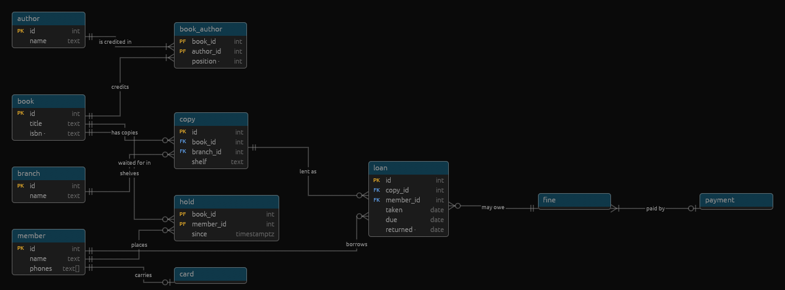

# Ferd

Ferd draws the tables of a database as boxes you can drag around, and keeps
where you put them.



It reads:

- Markdown files with mermaid `erDiagram` blocks. Each block becomes one
  diagram, named after the nearest heading above it.
- Postgres or MySQL schema files (`.sql`). Foreign keys become links and
  `--` comments become notes.

Table positions and hand-drawn links are saved in a `.ferd` file next to the
source, for example `schema.md.ferd`. The source file is never written. When
the source changes on disk, Ferd reloads it and keeps the positions.

## What it does

- Pan by dragging empty space, zoom with the scroll wheel or a pinch.
- Arrange places the tables in columns that follow the links, left to right,
  with as few crossings as it can find. Undo arrange puts them back.
- Links bend at right angles around tables and carry their label and
  cardinality marks.
- Clicking a table fades every link that does not touch it.
- Hand-drawn links: add links the source does not have.
- Export PNG saves the diagram as an image.
- Share lets others see and move the same diagram live.

## Running

```sh
cargo run --release -- path/to/schema.md
```

`./bundle.sh [target]` builds `target/<target>/Ferd.app` for macOS, for this Mac's CPU unless a target such as `x86_64-apple-darwin` is given; `-i` installs it into `/Applications`.

## Sharing

Share copies a ticket to the clipboard. The other person presses Join… and
pastes it, or runs `ferd --join <ticket>`. They need no copy of the file: the
source and layout come over the connection, and only the host saves.

Connections go straight between the two machines with iroh
(https://iroh.computer). When no direct path exists, the traffic goes
through n0's public relay. To use your own relay instead, run `iroh-relay`
and set `FERD_RELAY=<url>` on both sides.

## License

BSD 3-Clause, see `LICENSE`.
