# Whole company

The resource planning of a mid-sized company that makes, stores, sells and
services its own products: 400 tables across 15 areas.

## Everything

All areas in one diagram.

```mermaid
erDiagram
    currency {
        text code PK
        text name
    }
    country {
        text code PK
        text currency_code FK
        text name
        text description
    }
    language {
        text code PK
        text name
    }
    unit {
        text code PK
        text name
        text description
    }
    time_zone {
        text code PK
        text name
        timestamptz updated_at
    }
    unit_conversion {
        bigint id PK
        text from_unit_code FK
        text to_unit_code FK
        text name
        timestamptz created_at
    }
    exchange_rate {
        bigint id PK
        text from_currency_code FK
        text to_currency_code FK
        text name
        text status "new, in progress or resolved"
        timestamptz created_at
    }
    company {
        bigint id PK
        text currency_code FK
        text country_code FK
        text time_zone_code FK
        text name
        timestamptz created_at
    }
    branch {
        bigint id PK
        bigint company_id FK
        text country_code FK
        text name
        text status "draft, open, closed or cancelled"
        timestamptz created_at
    }
    region {
        bigint id PK
        text country_code FK
        text name
        timestamptz created_at
    }
    address {
        bigint id PK
        text country_code FK
        bigint region_id FK "null when there is no region"
        text name
        text status "new, in progress or resolved"
        timestamptz created_at
    }
    calendar {
        bigint id PK
        bigint company_id FK
        text name
        date starts_on
        date ends_on
    }
    holiday {
        bigint id PK
        bigint calendar_id FK
        text name
        date starts_on
        date ends_on
    }
    fiscal_year {
        bigint id PK
        bigint company_id FK
        text name
        date starts_on
        date ends_on
        timestamptz updated_at
    }
    fiscal_period {
        bigint id PK
        bigint fiscal_year_id FK
        text name
        date starts_on
        date ends_on
    }
    document_type {
        bigint id PK
        text code UK
        text name
        text description
    }
    number_sequence {
        bigint id PK
        bigint document_type_id FK
        bigint company_id FK
        text name
        text status "draft, open, closed or cancelled"
        timestamptz created_at
    }
    attachment {
        bigint id PK
        bigint uploaded_by_id FK
        text name
        timestamptz created_at
    }
    note {
        bigint id PK
        bigint user_account_id FK
        text number UK
        text status "new, in progress or resolved"
        timestamptz issued_at
        numeric total
    }
    tag {
        bigint id PK
        text code UK
        text name
        text description
    }
    tag_link {
        bigint id PK
        bigint tag_id FK
        text name
        text status "draft, open, closed or cancelled"
        timestamptz created_at
    }
    setting {
        bigint id PK
        bigint company_id FK
        text name
        timestamptz created_at
    }
    user_account {
        bigint id PK
        text language_code FK
        text time_zone_code FK "null when there is no time zone"
        bigint employee_id FK "null when there is no employee"
        text name
        text email UK
        text[] phones
        timestamptz updated_at
    }
    role {
        bigint id PK
        text code UK
        text name
        text description
    }
    permission {
        bigint id PK
        text code UK
        text name
    }
    role_permission {
        bigint role_id PK, FK
        bigint permission_id PK, FK
        timestamptz created_at
    }
    user_role {
        bigint user_account_id PK, FK
        bigint role_id PK, FK
        date since
    }
    audit_log {
        bigint id PK
        bigint user_account_id FK
        timestamptz happened_at
        jsonb details
    }
    department {
        bigint id PK
        bigint company_id FK
        bigint parent_id FK "null at the top"
        bigint manager_id FK "null when there is no manager"
        text name
        text status "draft, open, closed or cancelled"
        timestamptz created_at
    }
    job_title {
        bigint id PK
        text code UK
        text name
        text description
    }
    job_position {
        bigint id PK
        bigint department_id FK
        bigint job_title_id FK
        text name
        text status "new, in progress or resolved"
        timestamptz created_at
    }
    employee {
        bigint id PK
        bigint company_id FK
        bigint department_id FK
        bigint job_position_id FK "null when there is no job position"
        bigint manager_id FK "null when there is no manager"
        bigint address_id FK "null when there is no address"
        text name
        text email UK
        text[] phones
        timestamptz updated_at
    }
    employment_contract {
        bigint id PK
        bigint employee_id FK
        bigint job_position_id FK
        text currency_code FK
        text number UK
        text status "draft, open, closed or cancelled"
        timestamptz issued_at
    }
    salary_band {
        bigint id PK
        bigint job_title_id FK
        text currency_code FK
        text name
        timestamptz created_at
    }
    salary_component {
        bigint id PK
        int line_no
        numeric quantity
        numeric unit_price
        numeric amount
    }
    salary {
        bigint id PK
        bigint employee_id FK
        bigint salary_band_id FK "null when there is no salary band"
        text name
        timestamptz created_at
    }
    payroll_run {
        bigint id PK
        bigint company_id FK
        bigint fiscal_period_id FK
        timestamptz happened_at
        jsonb details
    }
    payslip {
        bigint id PK
        bigint payroll_run_id FK
        bigint employee_id FK
        text name
        timestamptz created_at
    }
    payslip_line {
        bigint id PK
        bigint payslip_id FK
        bigint salary_component_id FK
        int line_no
        numeric quantity
        numeric unit_price
        numeric amount
    }
    timesheet {
        bigint id PK
        bigint employee_id FK
        bigint approver_id FK "null when there is no approver"
        text name
        timestamptz created_at
    }
    timesheet_line {
        bigint id PK
        bigint timesheet_id FK
        bigint project_id FK "null when there is no project"
        bigint task_id FK "null when there is no task"
        int line_no
        numeric quantity
        numeric unit_price
        numeric amount
        timestamptz updated_at
    }
    leave_type {
        bigint id PK
        text code UK
        text name
        text description
    }
    leave_request {
        bigint id PK
        bigint employee_id FK
        bigint leave_type_id FK
        bigint approver_id FK "null when there is no approver"
        text number UK
        text status "new, in progress or resolved"
        timestamptz issued_at
        numeric total
    }
    leave_balance {
        bigint id PK
        bigint employee_id FK
        bigint leave_type_id FK
        text name
        timestamptz created_at
    }
    training_course {
        bigint id PK
        text code UK
        text name
    }
    training_session {
        bigint id PK
        bigint training_course_id FK
        bigint trainer_id FK "null when there is no trainer"
        text name
        date starts_on
        date ends_on
    }
    training_enrollment {
        bigint training_session_id PK, FK
        bigint employee_id PK, FK
        date since
    }
    skill {
        bigint id PK
        text code UK
        text name
        text description
    }
    employee_skill {
        bigint employee_id PK, FK
        bigint skill_id PK, FK
        date since
    }
    performance_review {
        bigint id PK
        bigint employee_id FK
        bigint reviewer_id FK
        text number UK
        text status "planned, running, done or failed"
        timestamptz issued_at
        numeric total
        timestamptz updated_at
    }
    review_goal {
        bigint id PK
        bigint performance_review_id FK
        text number UK
        text status "new, in progress or resolved"
        timestamptz issued_at
    }
    benefit_plan {
        bigint id PK
        bigint company_id FK
        text name
        timestamptz created_at
    }
    benefit_enrollment {
        bigint benefit_plan_id PK, FK
        bigint employee_id PK, FK
        date since
    }
    expense_claim {
        bigint id PK
        bigint employee_id FK
        text currency_code FK
        bigint approver_id FK "null when there is no approver"
        text number UK
        text status "planned, running, done or failed"
        timestamptz issued_at
    }
    expense_line {
        bigint id PK
        bigint expense_claim_id FK
        bigint cost_center_id FK "null when there is no cost center"
        bigint tax_code_id FK "null when there is no tax code"
        int line_no
        numeric quantity
        numeric unit_price
        numeric amount
    }
    job_opening {
        bigint id PK
        bigint department_id FK
        bigint job_position_id FK
        text name
        timestamptz created_at
    }
    candidate {
        bigint id PK
        bigint job_opening_id FK
        text name
        text email UK
        text[] phones
    }
    interview {
        bigint id PK
        bigint candidate_id FK
        bigint interviewer_id FK
        text name
        timestamptz created_at
    }
    customer_group {
        bigint id PK
        text code UK
        text name
        timestamptz updated_at
    }
    sales_channel {
        bigint id PK
        text code UK
        text name
        text description
    }
    sales_rep {
        bigint id PK
        bigint employee_id FK
        text name
        text email UK
        text[] phones
        date joined_on
    }
    customer {
        bigint id PK
        bigint customer_group_id FK "null when there is no customer group"
        text currency_code FK
        bigint payment_term_id FK
        bigint sales_rep_id FK "null when there is no sales rep"
        text language_code FK "null when there is no language"
        text name
        text email UK
        text[] phones
    }
    customer_contact {
        bigint id PK
        bigint customer_id FK
        text name
        text email UK
        text[] phones
    }
    customer_address {
        bigint id PK
        bigint customer_id FK
        bigint address_id FK
        text name
        timestamptz created_at
    }
    price_list {
        bigint id PK
        text currency_code FK
        bigint company_id FK
        text name
        text status "draft, open, closed or cancelled"
        timestamptz created_at
    }
    price_list_item {
        bigint id PK
        bigint price_list_id FK
        bigint product_id FK
        text unit_code FK
        int line_no
        numeric quantity
        numeric amount
    }
    discount_rule {
        bigint id PK
        bigint price_list_id FK
        bigint customer_group_id FK "null when there is no customer group"
        bigint product_category_id FK "null when there is no product category"
        text name
        text status "new, in progress or resolved"
        timestamptz created_at
    }
    lead_source {
        bigint id PK
        text code UK
        text name
        text description
        timestamptz updated_at
    }
    lead {
        bigint id PK
        bigint lead_source_id FK
        bigint owner_id FK "null when there is no owner"
        text name
        text email UK
        text[] phones
    }
    opportunity {
        bigint id PK
        bigint customer_id FK
        bigint lead_id FK "null when there is no lead"
        bigint sales_rep_id FK
        text name
        timestamptz created_at
    }
    campaign {
        bigint id PK
        bigint company_id FK
        text name
        text status "new, in progress or resolved"
        timestamptz created_at
    }
    campaign_member {
        bigint campaign_id PK, FK
        bigint lead_id PK, FK
        timestamptz created_at
    }
    quotation {
        bigint id PK
        bigint customer_id FK
        bigint sales_rep_id FK
        text currency_code FK
        bigint opportunity_id FK "null when there is no opportunity"
        bigint price_list_id FK
        text number UK
        text status "draft, open, closed or cancelled"
        timestamptz issued_at
        numeric total
    }
    quotation_line {
        bigint id PK
        bigint quotation_id FK
        bigint product_id FK
        text unit_code FK
        bigint tax_code_id FK
        int line_no
        numeric quantity
        numeric amount
    }
    sales_order {
        bigint id PK
        bigint customer_id FK
        bigint sales_rep_id FK "null when there is no sales rep"
        text currency_code FK
        bigint payment_term_id FK
        bigint quotation_id FK "null when there is no quotation"
        bigint billing_address_id FK
        bigint shipping_address_id FK
        bigint sales_channel_id FK
        text number UK
        text status "new, in progress or resolved"
        timestamptz issued_at
    }
    sales_order_line {
        bigint id PK
        bigint sales_order_id FK
        bigint product_id FK
        text unit_code FK
        bigint tax_code_id FK
        bigint warehouse_id FK "null when there is no warehouse"
        int line_no
        numeric quantity
        numeric amount
    }
    commission_plan {
        bigint id PK
        bigint company_id FK
        text number UK
        text status "draft, open, closed or cancelled"
        timestamptz issued_at
        numeric total
        timestamptz updated_at
    }
    commission {
        bigint id PK
        bigint sales_rep_id FK
        bigint commission_plan_id FK
        bigint sales_order_id FK
        text number UK
        text status "planned, running, done or failed"
        timestamptz issued_at
    }
    sales_target {
        bigint id PK
        bigint sales_rep_id FK
        bigint fiscal_period_id FK
        text name
        text status "new, in progress or resolved"
        timestamptz created_at
    }
    return_reason {
        bigint id PK
        text code UK
        text name
        text description
    }
    sales_return {
        bigint id PK
        bigint sales_order_id FK
        bigint customer_id FK
        bigint return_reason_id FK
        text number UK
        text status "draft, open, closed or cancelled"
        timestamptz issued_at
    }
    sales_return_line {
        bigint id PK
        bigint sales_return_id FK
        bigint sales_order_line_id FK
        bigint product_id FK
        int line_no
        numeric quantity
        numeric amount
    }
    contract {
        bigint id PK
        bigint customer_id FK
        text currency_code FK
        bigint sales_rep_id FK "null when there is no sales rep"
        text number UK
        text status "new, in progress or resolved"
        timestamptz issued_at
        numeric total
    }
    contract_line {
        bigint id PK
        bigint contract_id FK
        bigint product_id FK
        int line_no
        numeric quantity
        numeric amount
    }
    subscription {
        bigint id PK
        bigint customer_id FK
        bigint product_id FK
        bigint contract_id FK "null when there is no contract"
        text name
        text status "draft, open, closed or cancelled"
        timestamptz created_at
    }
    subscription_period {
        bigint id PK
        bigint subscription_id FK
        bigint customer_invoice_id FK "null when there is no customer invoice"
        text name
        date starts_on
        date ends_on
        timestamptz updated_at
    }
    purchase_category {
        bigint id PK
        text code UK
        text name
    }
    buyer {
        bigint id PK
        bigint employee_id FK
        text name
        text email UK
        text[] phones
        date joined_on
    }
    supplier {
        bigint id PK
        text currency_code FK
        bigint payment_term_id FK
        text country_code FK
        bigint buyer_id FK "null when there is no buyer"
        text name
        text email UK
        text[] phones
    }
    supplier_contact {
        bigint id PK
        bigint supplier_id FK
        text name
        text email UK
        text[] phones
    }
    supplier_address {
        bigint id PK
        bigint supplier_id FK
        bigint address_id FK
        text name
        text status "new, in progress or resolved"
        timestamptz created_at
    }
    supplier_rating {
        bigint id PK
        bigint supplier_id FK
        bigint rated_by_id FK
        text name
        timestamptz created_at
    }
    purchase_requisition {
        bigint id PK
        bigint requested_by_id FK
        bigint department_id FK
        bigint cost_center_id FK "null when there is no cost center"
        text number UK
        text status "draft, open, closed or cancelled"
        timestamptz issued_at
    }
    requisition_line {
        bigint id PK
        bigint purchase_requisition_id FK
        bigint product_id FK
        text unit_code FK
        bigint purchase_category_id FK "null when there is no purchase category"
        int line_no
        numeric quantity
        numeric amount
    }
    request_for_quote {
        bigint id PK
        bigint purchase_requisition_id FK "null when there is no purchase requisition"
        bigint buyer_id FK
        text number UK
        text status "new, in progress or resolved"
        timestamptz issued_at
        numeric total
        timestamptz updated_at
    }
    rfq_line {
        bigint id PK
        bigint request_for_quote_id FK
        bigint requisition_line_id FK "null when there is no requisition line"
        bigint product_id FK
        int line_no
        numeric quantity
        numeric amount
    }
    rfq_supplier {
        bigint request_for_quote_id PK, FK
        bigint supplier_id PK, FK
        date since
    }
    supplier_quote {
        bigint id PK
        bigint request_for_quote_id FK
        bigint supplier_id FK
        text currency_code FK
        text number UK
        text status "planned, running, done or failed"
        timestamptz issued_at
        numeric total
    }
    supplier_quote_line {
        bigint id PK
        bigint supplier_quote_id FK
        bigint rfq_line_id FK
        text unit_code FK
        int line_no
        numeric quantity
        numeric unit_price
        numeric amount
    }
    purchase_order {
        bigint id PK
        bigint supplier_id FK
        bigint buyer_id FK
        text currency_code FK
        bigint payment_term_id FK
        bigint supplier_quote_id FK "null when there is no supplier quote"
        bigint deliver_to_id FK
        text incoterm_code FK "null when there is no incoterm"
        text number UK
        text status "pending, approved or rejected"
        timestamptz issued_at
        numeric total
    }
    purchase_order_line {
        bigint id PK
        bigint purchase_order_id FK
        bigint product_id FK
        text unit_code FK
        bigint tax_code_id FK
        bigint requisition_line_id FK "null when there is no requisition line"
        int line_no
        numeric quantity
        numeric unit_price
        numeric amount
    }
    goods_receipt {
        bigint id PK
        bigint purchase_order_id FK
        bigint warehouse_id FK
        bigint received_by_id FK
        text number UK
        text status "planned, running, done or failed"
        timestamptz issued_at
    }
    goods_receipt_line {
        bigint id PK
        bigint goods_receipt_id FK
        bigint purchase_order_line_id FK
        bigint bin_id FK "null when there is no bin"
        bigint lot_id FK "null when there is no lot"
        int line_no
        numeric quantity
        numeric unit_price
        numeric amount
    }
    purchase_invoice {
        bigint id PK
        bigint supplier_id FK
        bigint purchase_order_id FK "null when there is no purchase order"
        text currency_code FK
        bigint payment_term_id FK
        text number UK
        text status "pending, approved or rejected"
        timestamptz issued_at
        numeric total
        timestamptz updated_at
    }
    purchase_invoice_line {
        bigint id PK
        bigint purchase_invoice_id FK
        bigint purchase_order_line_id FK "null when there is no purchase order line"
        bigint account_id FK
        bigint tax_code_id FK
        int line_no
        numeric quantity
        numeric unit_price
        numeric amount
    }
    purchase_return {
        bigint id PK
        bigint supplier_id FK
        bigint goods_receipt_id FK
        text number UK
        text status "planned, running, done or failed"
        timestamptz issued_at
        numeric total
    }
    purchase_return_line {
        bigint id PK
        bigint purchase_return_id FK
        bigint goods_receipt_line_id FK
        int line_no
        numeric quantity
        numeric unit_price
        numeric amount
    }
    supplier_price {
        bigint id PK
        bigint supplier_id FK
        bigint product_id FK
        text currency_code FK
        text unit_code FK
        text name
        timestamptz created_at
    }
    blanket_order {
        bigint id PK
        bigint supplier_id FK
        bigint buyer_id FK
        text currency_code FK
        text number UK
        text status "draft, open, closed or cancelled"
        timestamptz issued_at
        numeric total
    }
    blanket_order_line {
        bigint id PK
        bigint blanket_order_id FK
        bigint product_id FK
        int line_no
        numeric quantity
        numeric amount
    }
    approval_rule {
        bigint id PK
        bigint document_type_id FK
        bigint company_id FK
        text name
        text status "new, in progress or resolved"
        timestamptz created_at
    }
    approval_step {
        bigint id PK
        bigint approval_rule_id FK
        bigint role_id FK
        text name
        timestamptz created_at
    }
    approval {
        bigint id PK
        bigint approval_step_id FK
        bigint approver_id FK
        text name
        text status "draft, open, closed or cancelled"
        timestamptz created_at
        timestamptz updated_at
    }
    product_category {
        bigint id PK
        bigint parent_id FK "null at the top"
        text code UK
        text name
        text description
    }
    brand {
        bigint id PK
        text code UK
        text name
    }
    product {
        bigint id PK
        bigint product_category_id FK
        text unit_code FK
        bigint brand_id FK "null when there is no brand"
        bigint tax_code_id FK
        text name
        timestamptz created_at
    }
    product_variant {
        bigint id PK
        bigint product_id FK
        text name
        text status "draft, open, closed or cancelled"
        timestamptz created_at
    }
    attribute {
        bigint id PK
        text code UK
        text name
        text description
    }
    attribute_value {
        bigint id PK
        bigint attribute_id FK
        text name
        text status "new, in progress or resolved"
        timestamptz created_at
    }
    variant_attribute {
        bigint product_variant_id PK, FK
        bigint attribute_value_id PK, FK
        timestamptz created_at
    }
    barcode {
        bigint id PK
        bigint product_variant_id FK
        text name
        text status "draft, open, closed or cancelled"
        timestamptz created_at
    }
    warehouse {
        bigint id PK
        bigint company_id FK
        bigint address_id FK
        bigint manager_id FK "null when there is no manager"
        text name
        timestamptz created_at
        timestamptz updated_at
    }
    storage_zone {
        bigint id PK
        bigint warehouse_id FK
        text name
        text status "new, in progress or resolved"
        timestamptz created_at
    }
    bin {
        bigint id PK
        bigint storage_zone_id FK
        text name
        timestamptz created_at
    }
    stock_level {
        bigint product_variant_id PK, FK
        bigint bin_id PK, FK
        int on_hand
        int reserved "held for orders not yet shipped"
    }
    lot {
        bigint id PK
        bigint product_id FK
        bigint supplier_id FK "null when there is no supplier"
        text name
        timestamptz created_at
    }
    serial_number {
        bigint id PK
        bigint product_variant_id FK
        bigint lot_id FK "null when there is no lot"
        text name
        text status "new, in progress or resolved"
        timestamptz created_at
    }
    stock_move {
        bigint id PK
        bigint product_variant_id FK
        bigint from_bin_id FK "null when there is no from bin"
        bigint to_bin_id FK "null when there is no to bin"
        text unit_code FK
        bigint lot_id FK "null when there is no lot"
        timestamptz happened_at
        jsonb details
    }
    stock_count {
        bigint id PK
        bigint warehouse_id FK
        bigint counted_by_id FK
        text name
        text status "draft, open, closed or cancelled"
        timestamptz created_at
    }
    stock_count_line {
        bigint id PK
        bigint stock_count_id FK
        bigint bin_id FK
        bigint product_variant_id FK
        int line_no
        numeric quantity
        numeric amount
    }
    reorder_rule {
        bigint id PK
        bigint product_variant_id FK
        bigint warehouse_id FK
        bigint preferred_id FK "null when there is no preferred"
        text name
        text status "new, in progress or resolved"
        timestamptz created_at
        timestamptz updated_at
    }
    transfer_order {
        bigint id PK
        bigint from_warehouse_id FK
        bigint to_warehouse_id FK
        bigint carrier_id FK "null when there is no carrier"
        text number UK
        text status "pending, approved or rejected"
        timestamptz issued_at
    }
    transfer_line {
        bigint id PK
        bigint transfer_order_id FK
        bigint product_variant_id FK
        text unit_code FK
        int line_no
        numeric quantity
        numeric unit_price
        numeric amount
    }
    stock_reservation {
        bigint id PK
        bigint product_variant_id FK
        bigint sales_order_line_id FK
        bigint bin_id FK
        text name
        timestamptz created_at
    }
    adjustment_reason {
        bigint id PK
        text code UK
        text name
    }
    stock_adjustment {
        bigint id PK
        bigint warehouse_id FK
        bigint adjustment_reason_id FK
        bigint approved_by_id FK "null when there is no approved by"
        text name
        timestamptz created_at
    }
    adjustment_line {
        bigint id PK
        bigint stock_adjustment_id FK
        bigint product_variant_id FK
        bigint bin_id FK
        int line_no
        numeric quantity
        numeric unit_price
        numeric amount
    }
    packaging {
        bigint id PK
        bigint product_id FK
        text unit_code FK
        text name
        timestamptz created_at
    }
    product_supplier {
        bigint product_id PK, FK
        bigint supplier_id PK, FK
        date since
    }
    kit {
        bigint id PK
        bigint product_id FK
        text name
        timestamptz created_at
        timestamptz updated_at
    }
    kit_component {
        bigint id PK
        bigint kit_id FK
        bigint product_variant_id FK
        int line_no
        numeric quantity
        numeric unit_price
        numeric amount
    }
    bill_of_materials {
        bigint id PK
        bigint product_id FK
        text unit_code FK
        text name
        timestamptz created_at
    }
    bom_line {
        bigint id PK
        bigint bill_of_materials_id FK
        bigint component_id FK
        text unit_code FK
        int line_no
        numeric quantity
        numeric unit_price
        numeric amount
    }
    work_center {
        bigint id PK
        bigint warehouse_id FK "null when there is no warehouse"
        bigint cost_center_id FK
        text name
        timestamptz created_at
    }
    shift {
        bigint id PK
        bigint company_id FK
        text name
        date starts_on
        date ends_on
    }
    work_center_capacity {
        bigint id PK
        bigint work_center_id FK
        bigint shift_id FK
        text name
        timestamptz created_at
    }
    routing {
        bigint id PK
        bigint product_id FK
        bigint bill_of_materials_id FK "null when there is no bill of materials"
        text name
        text status "new, in progress or resolved"
        timestamptz created_at
    }
    routing_step {
        bigint id PK
        bigint routing_id FK
        bigint work_center_id FK
        text name
        timestamptz created_at
    }
    machine {
        bigint id PK
        bigint work_center_id FK
        bigint fixed_asset_id FK "null when there is no fixed asset"
        text name
        text status "draft, open, closed or cancelled"
        timestamptz created_at
        timestamptz updated_at
    }
    tool {
        bigint id PK
        bigint work_center_id FK "null when there is no work center"
        text name
        timestamptz created_at
    }
    production_order {
        bigint id PK
        bigint product_id FK
        bigint bill_of_materials_id FK
        bigint routing_id FK
        bigint warehouse_id FK
        bigint sales_order_line_id FK "null when there is no sales order line"
        text number UK
        text status "new, in progress or resolved"
        timestamptz issued_at
        numeric total
    }
    production_step {
        bigint id PK
        bigint production_order_id FK
        bigint routing_step_id FK
        bigint machine_id FK "null when there is no machine"
        text name
        timestamptz created_at
    }
    material_issue {
        bigint id PK
        bigint production_order_id FK
        bigint product_variant_id FK
        bigint bin_id FK
        bigint lot_id FK "null when there is no lot"
        text number UK
        text status "draft, open, closed or cancelled"
        timestamptz issued_at
    }
    production_output {
        bigint id PK
        bigint production_order_id FK
        bigint product_variant_id FK
        bigint bin_id FK
        bigint lot_id FK "null when there is no lot"
        text name
        timestamptz created_at
    }
    scrap_reason {
        bigint id PK
        text code UK
        text name
    }
    scrap {
        bigint id PK
        bigint production_order_id FK
        bigint product_variant_id FK
        bigint scrap_reason_id FK
        text name
        timestamptz created_at
    }
    shift_assignment {
        bigint shift_id PK, FK
        bigint employee_id PK, FK
        date since
    }
    downtime_reason {
        bigint id PK
        text code UK
        text name
        text description
        timestamptz updated_at
    }
    downtime {
        bigint id PK
        bigint machine_id FK
        bigint downtime_reason_id FK
        bigint reported_by_id FK
        text name
        text status "new, in progress or resolved"
        timestamptz created_at
    }
    maintenance_type {
        bigint id PK
        text code UK
        text name
        text description
    }
    maintenance_plan {
        bigint id PK
        bigint machine_id FK
        bigint maintenance_type_id FK
        text name
        text status "draft, open, closed or cancelled"
        timestamptz created_at
    }
    maintenance_order {
        bigint id PK
        bigint machine_id FK
        bigint maintenance_plan_id FK "null when there is no maintenance plan"
        bigint technician_id FK "null when there is no technician"
        text number UK
        text status "planned, running, done or failed"
        timestamptz issued_at
    }
    spare_part {
        bigint id PK
        bigint product_id FK
        text name
        text status "new, in progress or resolved"
        timestamptz created_at
    }
    maintenance_task {
        bigint id PK
        bigint maintenance_order_id FK
        bigint spare_part_id FK "null when there is no spare part"
        text name
        timestamptz created_at
    }
    mrp_run {
        bigint id PK
        bigint company_id FK
        bigint warehouse_id FK
        timestamptz happened_at
        jsonb details
    }
    planned_order {
        bigint id PK
        bigint mrp_run_id FK
        bigint product_id FK
        bigint supplier_id FK "null when there is no supplier"
        text number UK
        text status "planned, running, done or failed"
        timestamptz issued_at
        numeric total
    }
    demand_forecast {
        bigint id PK
        bigint company_id FK
        bigint fiscal_period_id FK
        text name
        text status "new, in progress or resolved"
        timestamptz created_at
        timestamptz updated_at
    }
    forecast_line {
        bigint id PK
        bigint demand_forecast_id FK
        bigint product_id FK
        bigint warehouse_id FK
        int line_no
        numeric quantity
        numeric amount
    }
    carrier {
        bigint id PK
        text code UK
        text name
    }
    carrier_service {
        bigint id PK
        bigint carrier_id FK
        text name
        timestamptz created_at
    }
    shipping_zone {
        bigint id PK
        text code UK
        text name
    }
    zone_country {
        bigint shipping_zone_id PK, FK
        text country_code PK, FK
        timestamptz created_at
    }
    shipping_rate {
        bigint id PK
        bigint carrier_service_id FK
        bigint shipping_zone_id FK
        text currency_code FK
        text name
        text status "draft, open, closed or cancelled"
        timestamptz created_at
    }
    incoterm {
        text code PK
        text name
        text description
    }
    vehicle {
        bigint id PK
        bigint company_id FK
        bigint fixed_asset_id FK "null when there is no fixed asset"
        text name
        text status "new, in progress or resolved"
        timestamptz created_at
    }
    driver {
        bigint id PK
        bigint employee_id FK
        text name
        text email UK
        text[] phones
        timestamptz updated_at
    }
    delivery_route {
        bigint id PK
        bigint warehouse_id FK
        bigint vehicle_id FK
        bigint driver_id FK
        text name
        text status "draft, open, closed or cancelled"
        timestamptz created_at
    }
    shipment {
        bigint id PK
        bigint sales_order_id FK "null when there is no sales order"
        bigint warehouse_id FK
        bigint carrier_service_id FK
        text incoterm_code FK "null when there is no incoterm"
        bigint delivery_route_id FK "null when there is no delivery route"
        text number UK
        text status "planned, running, done or failed"
        timestamptz issued_at
        numeric total
    }
    shipment_line {
        bigint id PK
        bigint shipment_id FK
        bigint sales_order_line_id FK "null when there is no sales order line"
        bigint product_variant_id FK
        bigint lot_id FK "null when there is no lot"
        int line_no
        numeric quantity
        numeric unit_price
        numeric amount
    }
    package {
        bigint id PK
        bigint shipment_id FK
        bigint packaging_id FK "null when there is no packaging"
        text name
        timestamptz created_at
    }
    package_item {
        bigint id PK
        bigint package_id FK
        bigint shipment_line_id FK
        int line_no
        numeric quantity
        numeric unit_price
        numeric amount
    }
    tracking_event {
        bigint id PK
        bigint shipment_id FK
        timestamptz happened_at
        jsonb details
    }
    route_stop {
        bigint id PK
        bigint delivery_route_id FK
        bigint address_id FK
        bigint shipment_id FK "null when there is no shipment"
        text name
        text status "new, in progress or resolved"
        timestamptz created_at
    }
    delivery_slot {
        bigint id PK
        bigint warehouse_id FK
        int line_no
        numeric quantity
        numeric amount
    }
    pick_list {
        bigint id PK
        bigint warehouse_id FK
        bigint picker_id FK "null when there is no picker"
        text name
        text status "draft, open, closed or cancelled"
        timestamptz created_at
        timestamptz updated_at
    }
    pick_line {
        bigint id PK
        bigint pick_list_id FK
        bigint sales_order_line_id FK
        bigint bin_id FK
        int line_no
        numeric quantity
        numeric amount
    }
    pack_station {
        bigint id PK
        bigint warehouse_id FK
        text name
        text status "new, in progress or resolved"
        timestamptz created_at
    }
    dock {
        bigint id PK
        bigint warehouse_id FK
        text name
        timestamptz created_at
    }
    dock_appointment {
        bigint id PK
        bigint dock_id FK
        bigint carrier_id FK
        bigint purchase_order_id FK "null when there is no purchase order"
        text name
        text status "draft, open, closed or cancelled"
        timestamptz created_at
    }
    customs_declaration {
        bigint id PK
        bigint shipment_id FK
        text country_code FK
        text number UK
        text status "planned, running, done or failed"
        timestamptz issued_at
        numeric total
    }
    customs_line {
        bigint id PK
        bigint customs_declaration_id FK
        bigint shipment_line_id FK
        int line_no
        numeric quantity
        numeric unit_price
        numeric amount
    }
    freight_invoice {
        bigint id PK
        bigint carrier_id FK
        text currency_code FK
        bigint purchase_invoice_id FK "null when there is no purchase invoice"
        text number UK
        text status "pending, approved or rejected"
        timestamptz issued_at
    }
    freight_charge {
        bigint id PK
        bigint freight_invoice_id FK
        bigint shipment_id FK
        text name
        text status "draft, open, closed or cancelled"
        timestamptz created_at
    }
    return_label {
        bigint id PK
        bigint shipment_id FK
        bigint sales_return_id FK
        text number UK
        text status "planned, running, done or failed"
        timestamptz issued_at
        numeric total
        timestamptz updated_at
    }
    chart_of_accounts {
        bigint id PK
        bigint company_id FK
        text name
        text status "new, in progress or resolved"
        timestamptz created_at
    }
    account_type {
        bigint id PK
        text code UK
        text name
        text description
    }
    account {
        bigint id PK
        bigint chart_of_accounts_id FK
        bigint account_type_id FK
        bigint parent_id FK "null at the top"
        text currency_code FK "null when there is no currency"
        text name
        text status "draft, open, closed or cancelled"
        timestamptz created_at
    }
    journal {
        bigint id PK
        bigint company_id FK
        bigint default_account_id FK "null when there is no default account"
        text name
        timestamptz created_at
    }
    journal_entry {
        bigint id PK
        bigint journal_id FK
        bigint fiscal_period_id FK
        bigint posted_by_id FK "null when there is no posted by"
        timestamptz happened_at
        jsonb details
    }
    journal_line {
        bigint id PK
        bigint journal_entry_id FK
        bigint account_id FK
        bigint cost_center_id FK "null when there is no cost center"
        bigint profit_center_id FK "null when there is no profit center"
        text currency_code FK
        int line_no
        numeric quantity
        numeric amount
    }
    tax_code {
        bigint id PK
        text country_code FK "null when there is no country"
        bigint account_id FK
        text name
        text status "draft, open, closed or cancelled"
        timestamptz created_at
    }
    tax_rate {
        bigint id PK
        bigint tax_code_id FK
        text name
        timestamptz created_at
    }
    tax_return {
        bigint id PK
        bigint company_id FK
        bigint fiscal_period_id FK
        text country_code FK
        text number UK
        text status "new, in progress or resolved"
        timestamptz issued_at
        numeric total
        timestamptz updated_at
    }
    tax_return_line {
        bigint id PK
        bigint tax_return_id FK
        bigint tax_code_id FK
        int line_no
        numeric quantity
        numeric amount
    }
    cost_center {
        bigint id PK
        bigint company_id FK
        bigint parent_id FK "null at the top"
        bigint manager_id FK "null when there is no manager"
        text name
        text status "draft, open, closed or cancelled"
        timestamptz created_at
    }
    profit_center {
        bigint id PK
        bigint company_id FK
        text name
        timestamptz created_at
    }
    budget {
        bigint id PK
        bigint company_id FK
        bigint fiscal_year_id FK
        text name
        text status "new, in progress or resolved"
        timestamptz created_at
    }
    budget_line {
        bigint id PK
        bigint budget_id FK
        bigint account_id FK
        bigint cost_center_id FK "null when there is no cost center"
        bigint fiscal_period_id FK
        int line_no
        numeric quantity
        numeric amount
    }
    bank {
        bigint id PK
        text code UK
        text name
    }
    bank_account {
        bigint id PK
        bigint bank_id FK
        bigint company_id FK
        text currency_code FK
        bigint account_id FK
        text name
        timestamptz created_at
    }
    bank_statement {
        bigint id PK
        bigint bank_account_id FK
        text number UK
        text status "new, in progress or resolved"
        timestamptz issued_at
        numeric total
    }
    bank_statement_line {
        bigint id PK
        bigint bank_statement_id FK
        bigint payment_id FK "null when there is no payment"
        int line_no
        numeric quantity
        numeric amount
        timestamptz updated_at
    }
    reconciliation {
        bigint id PK
        bigint bank_statement_line_id FK
        bigint journal_line_id FK
        text name
        text status "draft, open, closed or cancelled"
        timestamptz created_at
    }
    payment_method {
        bigint id PK
        text code UK
        text name
        text description
    }
    payment_term {
        bigint id PK
        text code UK
        text name
    }
    payment {
        bigint id PK
        bigint payment_method_id FK
        bigint bank_account_id FK
        text currency_code FK
        bigint customer_id FK "null when there is no customer"
        bigint supplier_id FK "null when there is no supplier"
        text number UK
        text status "pending, approved or rejected"
        timestamptz issued_at
    }
    payment_allocation {
        bigint id PK
        bigint payment_id FK
        bigint customer_invoice_id FK "null when there is no customer invoice"
        bigint purchase_invoice_id FK "null when there is no purchase invoice"
        text number UK
        text status "draft, open, closed or cancelled"
        timestamptz issued_at
        numeric total
    }
    customer_invoice {
        bigint id PK
        bigint customer_id FK
        bigint sales_order_id FK "null when there is no sales order"
        text currency_code FK
        bigint payment_term_id FK
        text number UK
        text status "planned, running, done or failed"
        timestamptz issued_at
        numeric total
    }
    customer_invoice_line {
        bigint id PK
        bigint customer_invoice_id FK
        bigint sales_order_line_id FK "null when there is no sales order line"
        bigint account_id FK
        bigint tax_code_id FK
        int line_no
        numeric quantity
        numeric unit_price
        numeric amount
    }
    credit_note {
        bigint id PK
        bigint customer_invoice_id FK
        bigint customer_id FK
        text number UK
        text status "pending, approved or rejected"
        timestamptz issued_at
        numeric total
    }
    credit_note_line {
        bigint id PK
        bigint credit_note_id FK
        bigint customer_invoice_line_id FK "null when there is no customer invoice line"
        int line_no
        numeric quantity
        numeric unit_price
        numeric amount
        timestamptz updated_at
    }
    dunning_level {
        bigint id PK
        text code UK
        text name
        text description
    }
    dunning_notice {
        bigint id PK
        bigint customer_invoice_id FK
        bigint dunning_level_id FK
        text number UK
        text status "new, in progress or resolved"
        timestamptz issued_at
        numeric total
    }
    depreciation_method {
        bigint id PK
        text code UK
        text name
        text description
    }
    asset_class {
        bigint id PK
        bigint depreciation_method_id FK
        text code UK
        text name
    }
    asset_location {
        bigint id PK
        bigint address_id FK "null when there is no address"
        text name
        timestamptz created_at
    }
    fixed_asset {
        bigint id PK
        bigint asset_class_id FK
        bigint company_id FK
        bigint asset_location_id FK "null when there is no asset location"
        bigint cost_center_id FK "null when there is no cost center"
        bigint supplier_id FK "null when there is no supplier"
        text name
        text status "new, in progress or resolved"
        timestamptz created_at
    }
    depreciation_schedule {
        bigint id PK
        bigint fixed_asset_id FK
        bigint depreciation_method_id FK
        bigint fiscal_year_id FK
        text name
        timestamptz created_at
    }
    depreciation_entry {
        bigint id PK
        bigint depreciation_schedule_id FK
        bigint journal_entry_id FK "null when there is no journal entry"
        bigint fiscal_period_id FK
        timestamptz happened_at
        jsonb details
    }
    asset_transfer {
        bigint id PK
        bigint fixed_asset_id FK
        bigint from_location_id FK
        bigint to_location_id FK
        text name
        timestamptz created_at
        timestamptz updated_at
    }
    asset_disposal {
        bigint id PK
        bigint fixed_asset_id FK
        bigint journal_entry_id FK "null when there is no journal entry"
        text name
        text status "new, in progress or resolved"
        timestamptz created_at
    }
    asset_revaluation {
        bigint id PK
        bigint fixed_asset_id FK
        bigint journal_entry_id FK "null when there is no journal entry"
        text name
        timestamptz created_at
    }
    lease {
        bigint id PK
        bigint fixed_asset_id FK
        bigint supplier_id FK
        text currency_code FK
        text number UK
        text status "draft, open, closed or cancelled"
        timestamptz issued_at
        numeric total
    }
    lease_payment {
        bigint id PK
        bigint lease_id FK
        bigint payment_id FK "null when there is no payment"
        text number UK
        text status "planned, running, done or failed"
        timestamptz issued_at
    }
    insurance_policy {
        bigint id PK
        bigint supplier_id FK
        text currency_code FK
        text name
        text status "new, in progress or resolved"
        timestamptz created_at
    }
    insured_asset {
        bigint insurance_policy_id PK, FK
        bigint fixed_asset_id PK, FK
        timestamptz created_at
    }
    insurance_claim {
        bigint id PK
        bigint insurance_policy_id FK
        bigint fixed_asset_id FK
        text number UK
        text status "draft, open, closed or cancelled"
        timestamptz issued_at
    }
    asset_inspection {
        bigint id PK
        bigint fixed_asset_id FK
        bigint inspector_id FK
        text number UK
        text status "planned, running, done or failed"
        timestamptz issued_at
        numeric total
    }
    warranty {
        bigint id PK
        bigint fixed_asset_id FK
        bigint supplier_id FK
        text name
        text status "new, in progress or resolved"
        timestamptz created_at
        timestamptz updated_at
    }
    warranty_claim {
        bigint id PK
        bigint warranty_id FK
        text number UK
        text status "pending, approved or rejected"
        timestamptz issued_at
    }
    asset_document {
        bigint id PK
        bigint fixed_asset_id FK
        bigint attachment_id FK
        text name
        text status "draft, open, closed or cancelled"
        timestamptz created_at
    }
    meter {
        bigint id PK
        bigint fixed_asset_id FK
        text unit_code FK
        text name
        timestamptz created_at
    }
    meter_reading {
        bigint id PK
        bigint meter_id FK
        bigint read_by_id FK "null when there is no read by"
        timestamptz happened_at
        jsonb details
    }
    asset_component {
        bigint id PK
        bigint fixed_asset_id FK
        bigint product_id FK "null when there is no product"
        int line_no
        numeric quantity
        numeric amount
    }
    asset_assignment {
        bigint id PK
        bigint fixed_asset_id FK
        bigint employee_id FK
        text name
        text status "draft, open, closed or cancelled"
        timestamptz created_at
    }
    asset_reservation {
        bigint id PK
        bigint fixed_asset_id FK
        bigint employee_id FK
        text name
        timestamptz created_at
    }
    asset_audit {
        bigint id PK
        bigint company_id FK
        bigint auditor_id FK
        text number UK
        text status "new, in progress or resolved"
        timestamptz issued_at
        numeric total
    }
    asset_audit_line {
        bigint id PK
        bigint asset_audit_id FK
        bigint fixed_asset_id FK
        int line_no
        numeric quantity
        numeric amount
        timestamptz updated_at
    }
    project_type {
        bigint id PK
        text code UK
        text name
    }
    project {
        bigint id PK
        bigint project_type_id FK
        bigint customer_id FK "null when there is no customer"
        bigint manager_id FK
        bigint company_id FK
        bigint contract_id FK "null when there is no contract"
        text name
        timestamptz created_at
    }
    project_member {
        bigint project_id PK, FK
        bigint employee_id PK, FK
        date since
    }
    project_phase {
        bigint id PK
        bigint project_id FK
        text name
        timestamptz created_at
    }
    milestone {
        bigint id PK
        bigint project_phase_id FK
        text name
        text status "draft, open, closed or cancelled"
        timestamptz created_at
    }
    task {
        bigint id PK
        bigint project_id FK
        bigint project_phase_id FK "null when there is no project phase"
        bigint parent_id FK "null at the top"
        text name
        timestamptz created_at
    }
    task_dependency {
        bigint id PK
        bigint task_id FK
        bigint depends_on_id FK
        text name
        text status "new, in progress or resolved"
        timestamptz created_at
    }
    task_assignment {
        bigint task_id PK, FK
        bigint employee_id PK, FK
        timestamptz created_at
    }
    time_entry {
        bigint id PK
        bigint employee_id FK
        bigint task_id FK
        bigint timesheet_line_id FK "null when there is no timesheet line"
        timestamptz happened_at
        jsonb details
        timestamptz updated_at
    }
    project_budget {
        bigint id PK
        bigint project_id FK
        text currency_code FK
        text name
        timestamptz created_at
    }
    project_cost {
        bigint id PK
        bigint project_id FK
        bigint account_id FK
        bigint journal_line_id FK "null when there is no journal line"
        text name
        text status "new, in progress or resolved"
        timestamptz created_at
    }
    project_invoice {
        bigint id PK
        bigint project_id FK
        bigint customer_invoice_id FK
        text number UK
        text status "pending, approved or rejected"
        timestamptz issued_at
        numeric total
    }
    project_risk {
        bigint id PK
        bigint project_id FK
        bigint owner_id FK "null when there is no owner"
        text name
        text status "draft, open, closed or cancelled"
        timestamptz created_at
    }
    issue {
        bigint id PK
        bigint project_id FK
        bigint reported_by_id FK
        bigint assigned_to_id FK "null when there is no assigned to"
        text number UK
        text status "planned, running, done or failed"
        timestamptz issued_at
        numeric total
    }
    issue_comment {
        bigint id PK
        bigint issue_id FK
        bigint user_account_id FK
        text number UK
        text status "new, in progress or resolved"
        timestamptz issued_at
        numeric total
    }
    change_request {
        bigint id PK
        bigint project_id FK
        bigint requested_by_id FK
        text number UK
        text status "pending, approved or rejected"
        timestamptz issued_at
    }
    deliverable {
        bigint id PK
        bigint milestone_id FK
        text name
        text status "draft, open, closed or cancelled"
        timestamptz created_at
    }
    resource_plan {
        bigint id PK
        bigint project_id FK
        text name
        timestamptz created_at
        timestamptz updated_at
    }
    resource_booking {
        bigint id PK
        bigint resource_plan_id FK
        bigint employee_id FK
        timestamptz happened_at
        jsonb details
    }
    project_document {
        bigint id PK
        bigint project_id FK
        bigint attachment_id FK
        text name
        timestamptz created_at
    }
    status_report {
        bigint id PK
        bigint project_id FK
        bigint author_id FK
        text number UK
        text status "draft, open, closed or cancelled"
        timestamptz issued_at
        numeric total
    }
    rate_card {
        bigint id PK
        text currency_code FK
        text name
        timestamptz created_at
    }
    rate_card_line {
        bigint id PK
        bigint rate_card_id FK
        bigint job_title_id FK
        int line_no
        numeric quantity
        numeric unit_price
        numeric amount
    }
    project_expense {
        bigint id PK
        bigint project_id FK
        bigint expense_line_id FK "null when there is no expense line"
        text name
        timestamptz created_at
    }
    baseline {
        bigint id PK
        bigint project_id FK
        text name
        text status "draft, open, closed or cancelled"
        timestamptz created_at
    }
    ticket_category {
        bigint id PK
        bigint parent_id FK "null at the top"
        text code UK
        text name
        text description
    }
    ticket_priority {
        bigint id PK
        text code UK
        text name
        timestamptz updated_at
    }
    support_team {
        bigint id PK
        bigint company_id FK
        text name
        timestamptz created_at
    }
    team_member {
        bigint support_team_id PK, FK
        bigint employee_id PK, FK
        date since
    }
    service_item {
        bigint id PK
        bigint product_id FK
        bigint customer_id FK
        bigint serial_number_id FK "null when there is no serial number"
        int line_no
        numeric quantity
        numeric amount
    }
    ticket {
        bigint id PK
        bigint customer_id FK
        bigint ticket_category_id FK
        bigint ticket_priority_id FK
        bigint support_team_id FK
        bigint assigned_to_id FK "null when there is no assigned to"
        bigint service_item_id FK "null when there is no service item"
        text number UK
        text status "new, in progress or resolved"
        timestamptz issued_at
    }
    ticket_comment {
        bigint id PK
        bigint ticket_id FK
        bigint user_account_id FK
        text number UK
        text status "pending, approved or rejected"
        timestamptz issued_at
        numeric total
    }
    ticket_attachment {
        bigint ticket_id PK, FK
        bigint attachment_id PK, FK
        date since
    }
    sla_policy {
        bigint id PK
        bigint company_id FK
        text name
        timestamptz created_at
    }
    sla_target {
        bigint id PK
        bigint sla_policy_id FK
        bigint ticket_priority_id FK
        text name
        text status "new, in progress or resolved"
        timestamptz created_at
    }
    service_contract {
        bigint id PK
        bigint customer_id FK
        bigint sla_policy_id FK
        bigint contract_id FK "null when there is no contract"
        text number UK
        text status "pending, approved or rejected"
        timestamptz issued_at
        numeric total
        timestamptz updated_at
    }
    service_contract_line {
        bigint id PK
        bigint service_contract_id FK
        bigint service_item_id FK
        int line_no
        numeric quantity
        numeric unit_price
        numeric amount
    }
    technician {
        bigint id PK
        bigint employee_id FK
        text name
        text email UK
        text[] phones
        date joined_on
    }
    technician_skill {
        bigint technician_id PK, FK
        bigint skill_id PK, FK
        date since
    }
    field_visit {
        bigint id PK
        bigint ticket_id FK
        bigint technician_id FK
        bigint address_id FK
        timestamptz happened_at
        jsonb details
    }
    visit_report {
        bigint id PK
        bigint field_visit_id FK
        text number UK
        text status "draft, open, closed or cancelled"
        timestamptz issued_at
        numeric total
    }
    spare_part_usage {
        bigint id PK
        bigint field_visit_id FK
        bigint spare_part_id FK
        bigint lot_id FK "null when there is no lot"
        timestamptz happened_at
        jsonb details
    }
    knowledge_article {
        bigint id PK
        bigint author_id FK
        bigint ticket_category_id FK
        text name
        text status "new, in progress or resolved"
        timestamptz created_at
    }
    article_feedback {
        bigint id PK
        bigint knowledge_article_id FK
        bigint customer_id FK "null when there is no customer"
        timestamptz happened_at
        jsonb details
    }
    escalation {
        bigint id PK
        bigint ticket_id FK
        bigint escalated_to_id FK
        text name
        text status "draft, open, closed or cancelled"
        timestamptz created_at
        timestamptz updated_at
    }
    survey {
        bigint id PK
        bigint company_id FK
        text name
        timestamptz created_at
    }
    survey_question {
        bigint id PK
        bigint survey_id FK
        text name
        text status "new, in progress or resolved"
        timestamptz created_at
    }
    survey_answer {
        bigint id PK
        bigint survey_question_id FK
        bigint ticket_id FK "null when there is no ticket"
        bigint customer_id FK
        text name
        timestamptz created_at
    }
    warranty_registration {
        bigint id PK
        bigint service_item_id FK
        bigint customer_id FK
        text name
        text status "draft, open, closed or cancelled"
        timestamptz created_at
    }
    callback_request {
        bigint id PK
        bigint customer_id FK
        bigint ticket_id FK "null when there is no ticket"
        text number UK
        text status "planned, running, done or failed"
        timestamptz issued_at
        numeric total
    }
    test_method {
        bigint id PK
        text code UK
        text name
    }
    inspection_plan {
        bigint id PK
        bigint product_id FK
        bigint test_method_id FK "null when there is no test method"
        text number UK
        text status "pending, approved or rejected"
        timestamptz issued_at
    }
    inspection_point {
        bigint id PK
        bigint inspection_plan_id FK
        bigint test_method_id FK
        text unit_code FK "null when there is no unit"
        text number UK
        text status "draft, open, closed or cancelled"
        timestamptz issued_at
        numeric total
    }
    inspection {
        bigint id PK
        bigint inspection_plan_id FK
        bigint goods_receipt_id FK "null when there is no goods receipt"
        bigint production_order_id FK "null when there is no production order"
        bigint inspector_id FK
        text number UK
        text status "planned, running, done or failed"
        timestamptz issued_at
        numeric total
        timestamptz updated_at
    }
    inspection_result {
        bigint id PK
        bigint inspection_id FK
        bigint inspection_point_id FK
        text number UK
        text status "new, in progress or resolved"
        timestamptz issued_at
    }
    defect_type {
        bigint id PK
        text code UK
        text name
        text description
    }
    defect {
        bigint id PK
        bigint inspection_id FK
        bigint defect_type_id FK
        bigint product_variant_id FK
        text name
        text status "draft, open, closed or cancelled"
        timestamptz created_at
    }
    nonconformance {
        bigint id PK
        bigint defect_id FK "null when there is no defect"
        bigint supplier_id FK "null when there is no supplier"
        bigint product_id FK
        bigint reported_by_id FK
        text number UK
        text status "planned, running, done or failed"
        timestamptz issued_at
    }
    corrective_action {
        bigint id PK
        bigint nonconformance_id FK
        bigint owner_id FK
        text name
        text status "new, in progress or resolved"
        timestamptz created_at
    }
    preventive_action {
        bigint id PK
        bigint nonconformance_id FK
        bigint owner_id FK
        text name
        timestamptz created_at
    }
    quality_audit {
        bigint id PK
        bigint company_id FK
        bigint auditor_id FK
        text number UK
        text status "draft, open, closed or cancelled"
        timestamptz issued_at
    }
    audit_finding {
        bigint id PK
        bigint quality_audit_id FK
        bigint nonconformance_id FK "null when there is no nonconformance"
        text number UK
        text status "planned, running, done or failed"
        timestamptz issued_at
        numeric total
    }
    certificate {
        bigint id PK
        bigint company_id FK
        bigint issued_by_id FK "null when there is no issued by"
        text name
        text status "new, in progress or resolved"
        timestamptz created_at
        timestamptz updated_at
    }
    certificate_requirement {
        bigint id PK
        bigint certificate_id FK
        text name
        timestamptz created_at
    }
    measuring_device {
        bigint id PK
        bigint fixed_asset_id FK "null when there is no fixed asset"
        text unit_code FK
        text name
        text status "draft, open, closed or cancelled"
        timestamptz created_at
    }
    calibration {
        bigint id PK
        bigint measuring_device_id FK
        bigint supplier_id FK "null when there is no supplier"
        text name
        timestamptz created_at
    }
    calibration_record {
        bigint id PK
        bigint calibration_id FK
        bigint performed_by_id FK
        timestamptz happened_at
        jsonb details
    }
    control_chart {
        bigint id PK
        bigint inspection_point_id FK
        bigint work_center_id FK
        text name
        timestamptz created_at
    }
    control_sample {
        bigint id PK
        bigint control_chart_id FK
        bigint production_order_id FK "null when there is no production order"
        text name
        text status "draft, open, closed or cancelled"
        timestamptz created_at
    }
    supplier_audit {
        bigint id PK
        bigint supplier_id FK
        bigint auditor_id FK
        text number UK
        text status "planned, running, done or failed"
        timestamptz issued_at
    }
    root_cause {
        bigint id PK
        text code UK
        text name
    }
    complaint {
        bigint id PK
        bigint customer_id FK
        bigint product_id FK
        bigint sales_order_id FK "null when there is no sales order"
        text name
        timestamptz created_at
        timestamptz updated_at
    }
    complaint_cause {
        bigint complaint_id PK, FK
        bigint root_cause_id PK, FK
        date since
    }
    eight_d_report {
        bigint id PK
        bigint complaint_id FK
        bigint owner_id FK
        text number UK
        text status "planned, running, done or failed"
        timestamptz issued_at
        numeric total
    }
    quality_cost {
        bigint id PK
        bigint nonconformance_id FK
        bigint account_id FK
        text currency_code FK
        text name
        text status "new, in progress or resolved"
        timestamptz created_at
    }
    segment {
        bigint id PK
        bigint company_id FK
        text name
        timestamptz created_at
    }
    segment_member {
        bigint segment_id PK, FK
        bigint customer_id PK, FK
        date since
    }
    newsletter {
        bigint id PK
        bigint company_id FK
        text language_code FK
        text name
        timestamptz created_at
    }
    newsletter_issue {
        bigint id PK
        bigint newsletter_id FK
        text number UK
        text status "new, in progress or resolved"
        timestamptz issued_at
    }
    subscription_consent {
        bigint id PK
        bigint customer_id FK
        bigint newsletter_id FK
        text name
        timestamptz created_at
    }
    ad_campaign {
        bigint id PK
        bigint company_id FK
        text currency_code FK
        bigint owner_id FK
        text name
        text status "draft, open, closed or cancelled"
        timestamptz created_at
        timestamptz updated_at
    }
    ad_group {
        bigint id PK
        bigint ad_campaign_id FK
        text code UK
        text name
        text description
    }
    landing_page {
        bigint id PK
        bigint ad_campaign_id FK "null when there is no ad campaign"
        text language_code FK
        text name
        text status "new, in progress or resolved"
        timestamptz created_at
    }
    ad {
        bigint id PK
        bigint ad_group_id FK
        bigint landing_page_id FK "null when there is no landing page"
        text name
        timestamptz created_at
    }
    ad_spend {
        bigint id PK
        bigint ad_id FK
        text currency_code FK
        text name
        text status "draft, open, closed or cancelled"
        timestamptz created_at
    }
    web_form {
        bigint id PK
        bigint landing_page_id FK
        text name
        timestamptz created_at
    }
    form_submission {
        bigint id PK
        bigint web_form_id FK
        bigint lead_id FK "null when there is no lead"
        timestamptz happened_at
        jsonb details
    }
    web_visit {
        bigint id PK
        bigint landing_page_id FK
        bigint customer_id FK "null when there is no customer"
        timestamptz happened_at
        jsonb details
    }
    coupon {
        bigint id PK
        bigint ad_campaign_id FK "null when there is no ad campaign"
        bigint promotion_id FK "null when there is no promotion"
        text name
        text status "draft, open, closed or cancelled"
        timestamptz created_at
    }
    coupon_redemption {
        bigint id PK
        bigint coupon_id FK
        bigint sales_order_id FK
        timestamptz happened_at
        jsonb details
        timestamptz updated_at
    }
    loyalty_program {
        bigint id PK
        bigint company_id FK
        text currency_code FK
        text name
        text status "new, in progress or resolved"
        timestamptz created_at
    }
    loyalty_tier {
        bigint id PK
        bigint loyalty_program_id FK
        text name
        timestamptz created_at
    }
    loyalty_account {
        bigint id PK
        bigint customer_id FK
        bigint loyalty_program_id FK
        bigint loyalty_tier_id FK
        text name
        text status "draft, open, closed or cancelled"
        timestamptz created_at
    }
    loyalty_transaction {
        bigint id PK
        bigint loyalty_account_id FK
        bigint sales_order_id FK "null when there is no sales order"
        bigint receipt_id FK "null when there is no receipt"
        timestamptz happened_at
        jsonb details
    }
    referral {
        bigint id PK
        bigint referrer_id FK
        bigint referred_id FK "null when there is no referred"
        text name
        text status "new, in progress or resolved"
        timestamptz created_at
    }
    social_post {
        bigint id PK
        bigint ad_campaign_id FK "null when there is no ad campaign"
        bigint author_id FK
        text name
        timestamptz created_at
    }
    marketing_event {
        bigint id PK
        bigint company_id FK
        bigint address_id FK "null when there is no address"
        timestamptz happened_at
        jsonb details
    }
    event_registration {
        bigint marketing_event_id PK, FK
        bigint customer_id PK, FK
        timestamptz created_at
    }
    persona {
        bigint id PK
        text code UK
        text name
        timestamptz updated_at
    }
    content_asset {
        bigint id PK
        bigint persona_id FK "null when there is no persona"
        bigint attachment_id FK
        bigint author_id FK
        text name
        timestamptz created_at
    }
    store {
        bigint id PK
        bigint company_id FK
        bigint address_id FK
        bigint warehouse_id FK
        bigint manager_id FK "null when there is no manager"
        text name
        text status "draft, open, closed or cancelled"
        timestamptz created_at
    }
    store_hours {
        bigint id PK
        bigint store_id FK
        text name
        date starts_on
        date ends_on
    }
    cash_register {
        bigint id PK
        bigint store_id FK
        text name
        text status "new, in progress or resolved"
        timestamptz created_at
    }
    register_session {
        bigint id PK
        bigint cash_register_id FK
        bigint cashier_id FK
        text name
        date starts_on
        date ends_on
    }
    cash_drawer {
        bigint id PK
        bigint cash_register_id FK
        text name
        text status "draft, open, closed or cancelled"
        timestamptz created_at
    }
    cash_count {
        bigint id PK
        bigint register_session_id FK
        bigint counted_by_id FK
        text name
        timestamptz created_at
    }
    promotion {
        bigint id PK
        bigint company_id FK
        text name
        text status "new, in progress or resolved"
        timestamptz created_at
    }
    promotion_rule {
        bigint id PK
        bigint promotion_id FK
        text name
        timestamptz created_at
        timestamptz updated_at
    }
    promotion_product {
        bigint promotion_id PK, FK
        bigint product_id PK, FK
        date since
    }
    gift_card {
        bigint id PK
        text currency_code FK
        bigint sold_in_id FK "null when there is no sold in"
        text name
        timestamptz created_at
    }
    receipt {
        bigint id PK
        bigint register_session_id FK
        bigint customer_id FK "null when there is no customer"
        text currency_code FK
        text number UK
        text status "new, in progress or resolved"
        timestamptz issued_at
        numeric total
    }
    receipt_line {
        bigint id PK
        bigint receipt_id FK
        bigint product_variant_id FK
        bigint promotion_id FK "null when there is no promotion"
        int line_no
        numeric quantity
        numeric amount
    }
    receipt_payment {
        bigint id PK
        bigint receipt_id FK
        bigint payment_method_id FK
        bigint gift_card_id FK "null when there is no gift card"
        text number UK
        text status "draft, open, closed or cancelled"
        timestamptz issued_at
        numeric total
    }
    gift_card_transaction {
        bigint id PK
        bigint gift_card_id FK
        bigint receipt_id FK "null when there is no receipt"
        timestamptz happened_at
        jsonb details
    }
    store_stock {
        bigint store_id PK, FK
        bigint product_variant_id PK, FK
        int on_hand
        int reserved "held for orders not yet shipped"
    }
    shelf {
        bigint id PK
        bigint store_id FK
        text name
        timestamptz created_at
    }
    planogram {
        bigint id PK
        bigint product_category_id FK
        text name
        text status "draft, open, closed or cancelled"
        timestamptz created_at
        timestamptz updated_at
    }
    planogram_slot {
        bigint id PK
        bigint planogram_id FK
        bigint product_variant_id FK
        int line_no
        numeric quantity
        numeric amount
    }
    shelf_planogram {
        bigint shelf_id PK, FK
        bigint planogram_id PK, FK
        date since
    }
    store_staff {
        bigint store_id PK, FK
        bigint employee_id PK, FK
        timestamptz created_at
    }
    shift_report {
        bigint id PK
        bigint store_id FK
        bigint register_session_id FK
        text name
        date starts_on
        date ends_on
    }
    customer_display {
        bigint id PK
        bigint cash_register_id FK
        text name
        timestamptz created_at
    }
    layaway {
        bigint id PK
        bigint customer_id FK
        bigint store_id FK
        text name
        text status "new, in progress or resolved"
        timestamptz created_at
    }
    layaway_payment {
        bigint id PK
        bigint layaway_id FK
        bigint receipt_payment_id FK "null when there is no receipt payment"
        text number UK
        text status "pending, approved or rejected"
        timestamptz issued_at
    }
    price_tag {
        bigint id PK
        bigint product_variant_id FK
        bigint store_id FK
        text name
        text status "draft, open, closed or cancelled"
        timestamptz created_at
    }
    store_transfer {
        bigint id PK
        bigint from_store_id FK
        bigint to_store_id FK
        bigint transfer_order_id FK "null when there is no transfer order"
        text name
        timestamptz created_at
        timestamptz updated_at
    }
    workflow {
        bigint id PK
        bigint document_type_id FK
        text name
        text status "new, in progress or resolved"
        timestamptz created_at
    }
    workflow_state {
        bigint id PK
        bigint workflow_id FK
        text name
        timestamptz created_at
    }
    workflow_transition {
        bigint id PK
        bigint workflow_id FK
        bigint from_state_id FK
        bigint to_state_id FK
        bigint role_id FK "null when there is no role"
        text name
        text status "draft, open, closed or cancelled"
        timestamptz created_at
    }
    workflow_instance {
        bigint id PK
        bigint workflow_id FK
        bigint current_state_id FK
        text name
        timestamptz created_at
    }
    workflow_task {
        bigint id PK
        bigint workflow_instance_id FK
        bigint assignee_id FK "null when there is no assignee"
        text name
        text status "new, in progress or resolved"
        timestamptz created_at
    }
    notification_template {
        bigint id PK
        text language_code FK
        text name
        timestamptz created_at
    }
    notification {
        bigint id PK
        bigint notification_template_id FK
        bigint user_account_id FK
        text name
        text status "draft, open, closed or cancelled"
        timestamptz created_at
    }
    email_message {
        bigint id PK
        bigint notification_id FK "null when there is no notification"
        bigint sent_by_id FK "null when there is no sent by"
        text name
        timestamptz created_at
    }
    email_recipient {
        bigint id PK
        bigint email_message_id FK
        text name
        text status "new, in progress or resolved"
        timestamptz created_at
        timestamptz updated_at
    }
    report_definition {
        bigint id PK
        bigint owner_id FK
        text number UK
        text status "pending, approved or rejected"
        timestamptz issued_at
    }
    report_run {
        bigint id PK
        bigint report_definition_id FK
        bigint user_account_id FK
        timestamptz happened_at
        jsonb details
    }
    dashboard {
        bigint id PK
        bigint owner_id FK
        text name
        timestamptz created_at
    }
    dashboard_widget {
        bigint id PK
        bigint dashboard_id FK
        bigint report_definition_id FK "null when there is no report definition"
        text name
        text status "new, in progress or resolved"
        timestamptz created_at
    }
    api_client {
        bigint id PK
        bigint company_id FK
        text name
        timestamptz created_at
    }
    api_token {
        bigint id PK
        bigint api_client_id FK
        text name
        text status "draft, open, closed or cancelled"
        timestamptz created_at
    }
    webhook {
        bigint id PK
        bigint api_client_id FK
        text name
        timestamptz created_at
    }
    webhook_delivery {
        bigint id PK
        bigint webhook_id FK
        timestamptz happened_at
        jsonb details
    }
    import_job {
        bigint id PK
        bigint user_account_id FK
        bigint document_type_id FK "null when there is no document type"
        text name
        timestamptz created_at
        timestamptz updated_at
    }
    import_row_error {
        bigint id PK
        bigint import_job_id FK
        timestamptz happened_at
        jsonb details
    }
    export_job {
        bigint id PK
        bigint user_account_id FK
        bigint report_definition_id FK "null when there is no report definition"
        text name
        timestamptz created_at
    }
    scheduled_job {
        bigint id PK
        bigint owner_id FK
        text name
        text status "new, in progress or resolved"
        timestamptz created_at
    }
    job_run {
        bigint id PK
        bigint scheduled_job_id FK
        timestamptz happened_at
        jsonb details
    }
    integration_mapping {
        bigint id PK
        bigint api_client_id FK
        text name
        text status "draft, open, closed or cancelled"
        timestamptz created_at
    }
    external_reference {
        bigint id PK
        bigint integration_mapping_id FK
        text name
        timestamptz created_at
    }
    data_retention_rule {
        bigint id PK
        bigint document_type_id FK
        text name
        text status "new, in progress or resolved"
        timestamptz created_at
    }
    feature_flag {
        bigint id PK
        bigint company_id FK
        text name
        timestamptz created_at
    }
    country }o..|| currency : uses
    unit_conversion }o..|| unit : "from unit"
    unit_conversion }o..|| unit : "to unit"
    exchange_rate }o..|| currency : "from currency"
    exchange_rate }o..|| currency : "to currency"
    company }o..|| currency : uses
    company }o..|| country : uses
    company }o..|| time_zone : uses
    company ||--o{ branch : has
    branch }o..|| country : uses
    country ||--o{ region : has
    address }o..|| country : uses
    region |o..o{ address : "may have"
    company ||..o{ calendar : "used by"
    calendar ||--o{ holiday : has
    company ||--o{ fiscal_year : has
    fiscal_year ||--o{ fiscal_period : has
    document_type ||--o{ number_sequence : has
    company ||..o{ number_sequence : "used by"
    user_account ||..o{ attachment : "uploaded by"
    user_account ||..o{ note : "used by"
    tag ||--o{ tag_link : has
    company ||..o{ setting : "used by"
    user_account }o..|| language : uses
    time_zone |o..o{ user_account : "may have"
    employee |o..o{ user_account : "may have"
    role ||--o{ role_permission : links
    permission ||--o{ role_permission : links
    user_account ||--o{ user_role : links
    role ||--o{ user_role : links
    user_account ||..o{ audit_log : "used by"
    company ||..o{ department : "used by"
    department |o..o{ department : "parent of"
    employee |o..o{ department : manager
    department ||--o{ job_position : has
    job_position }o..|| job_title : uses
    company ||..o{ employee : "used by"
    department ||..o{ employee : "used by"
    job_position |o..o{ employee : "may have"
    employee |o..o{ employee : manager
    address |o..o{ employee : "may have"
    employee ||--o{ employment_contract : has
    job_position ||..o{ employment_contract : "used by"
    employment_contract }o..|| currency : uses
    job_title ||--o{ salary_band : has
    salary_band }o..|| currency : uses
    employee ||--o{ salary : has
    salary_band |o..o{ salary : "may have"
    company ||..o{ payroll_run : "used by"
    fiscal_period ||..o{ payroll_run : "used by"
    payroll_run ||--o{ payslip : has
    employee ||..o{ payslip : "used by"
    payslip ||--|{ payslip_line : lists
    payslip_line }o..|| salary_component : uses
    employee ||--o{ timesheet : has
    employee |o..o{ timesheet : approver
    timesheet_line }|--|| timesheet : "listed in"
    project |o..o{ timesheet_line : "may have"
    task |o..o{ timesheet_line : "may have"
    employee ||--o{ leave_request : has
    leave_request }o..|| leave_type : uses
    employee |o..o{ leave_request : approver
    employee ||--o{ leave_balance : has
    leave_balance }o..|| leave_type : uses
    training_course ||--o{ training_session : has
    employee |o..o{ training_session : trainer
    training_session ||--o{ training_enrollment : links
    employee ||--o{ training_enrollment : links
    employee ||--o{ employee_skill : links
    skill ||--o{ employee_skill : links
    employee ||--o{ performance_review : has
    employee ||..o{ performance_review : reviewer
    performance_review ||--o{ review_goal : has
    company ||..o{ benefit_plan : "used by"
    benefit_plan ||--o{ benefit_enrollment : links
    employee ||--o{ benefit_enrollment : links
    employee ||--o{ expense_claim : has
    expense_claim }o..|| currency : uses
    employee |o..o{ expense_claim : approver
    expense_claim ||--|{ expense_line : lists
    cost_center |o..o{ expense_line : "may have"
    tax_code |o..o{ expense_line : "may have"
    department ||..o{ job_opening : "used by"
    job_position ||..o{ job_opening : "used by"
    job_opening ||..o{ candidate : "used by"
    candidate ||--o{ interview : has
    employee ||..o{ interview : interviewer
    employee ||--o| sales_rep : "has one"
    customer_group |o..o{ customer : "may have"
    customer }o..|| currency : uses
    customer }o..|| payment_term : uses
    sales_rep |o..o{ customer : "may have"
    language |o..o{ customer : "may have"
    customer ||--o{ customer_contact : has
    customer ||--o{ customer_address : has
    address ||..o{ customer_address : "used by"
    price_list }o..|| currency : uses
    company ||..o{ price_list : "used by"
    price_list ||--o{ price_list_item : has
    product ||..o{ price_list_item : "used by"
    price_list_item }o..|| unit : uses
    price_list ||--o{ discount_rule : has
    customer_group |o..o{ discount_rule : "may have"
    product_category |o..o{ discount_rule : "may have"
    lead }o..|| lead_source : uses
    sales_rep |o..o{ lead : owner
    customer ||..o{ opportunity : "used by"
    lead |o..o{ opportunity : "may have"
    sales_rep ||..o{ opportunity : "used by"
    company ||..o{ campaign : "used by"
    campaign ||--o{ campaign_member : links
    lead ||--o{ campaign_member : links
    customer ||..o{ quotation : "used by"
    sales_rep ||..o{ quotation : "used by"
    quotation }o..|| currency : uses
    opportunity |o..o{ quotation : "may have"
    price_list ||..o{ quotation : "used by"
    quotation_line }|--|| quotation : "listed in"
    product ||..o{ quotation_line : "used by"
    quotation_line }o..|| unit : uses
    tax_code ||..o{ quotation_line : "used by"
    customer ||..o{ sales_order : "used by"
    sales_rep |o..o{ sales_order : "may have"
    sales_order }o..|| currency : uses
    sales_order }o..|| payment_term : uses
    quotation |o..o{ sales_order : "may have"
    customer_address ||..o{ sales_order : "billing address"
    customer_address ||..o{ sales_order : "shipping address"
    sales_order }o..|| sales_channel : uses
    sales_order ||--|{ sales_order_line : lists
    product ||..o{ sales_order_line : "used by"
    sales_order_line }o..|| unit : uses
    tax_code ||..o{ sales_order_line : "used by"
    warehouse |o..o{ sales_order_line : "may have"
    company ||..o{ commission_plan : "used by"
    sales_rep ||..o{ commission : "used by"
    commission_plan ||..o{ commission : "used by"
    sales_order ||..o{ commission : "used by"
    sales_rep ||--o{ sales_target : has
    fiscal_period ||..o{ sales_target : "used by"
    sales_order ||..o{ sales_return : "used by"
    customer ||..o{ sales_return : "used by"
    sales_return }o..|| return_reason : uses
    sales_return_line }|--|| sales_return : "listed in"
    sales_order_line ||..o{ sales_return_line : "used by"
    product ||..o{ sales_return_line : "used by"
    customer ||..o{ contract : "used by"
    contract }o..|| currency : uses
    sales_rep |o..o{ contract : "may have"
    contract ||--|{ contract_line : lists
    product ||..o{ contract_line : "used by"
    customer ||..o{ subscription : "used by"
    product ||..o{ subscription : "used by"
    contract |o..o{ subscription : "may have"
    subscription ||--o{ subscription_period : has
    customer_invoice |o..o{ subscription_period : "may have"
    employee ||--o| buyer : "has one"
    supplier }o..|| currency : uses
    supplier }o..|| payment_term : uses
    supplier }o..|| country : uses
    buyer |o..o{ supplier : "may have"
    supplier ||--o{ supplier_contact : has
    supplier ||--o{ supplier_address : has
    address ||..o{ supplier_address : "used by"
    supplier ||--o{ supplier_rating : has
    employee ||..o{ supplier_rating : "rated by"
    employee ||..o{ purchase_requisition : "requested by"
    department ||..o{ purchase_requisition : "used by"
    cost_center |o..o{ purchase_requisition : "may have"
    requisition_line }|--|| purchase_requisition : "listed in"
    product ||..o{ requisition_line : "used by"
    requisition_line }o..|| unit : uses
    purchase_category |o..o{ requisition_line : "may have"
    purchase_requisition |o..o{ request_for_quote : "may have"
    buyer ||..o{ request_for_quote : "used by"
    request_for_quote ||--|{ rfq_line : lists
    requisition_line |o..o{ rfq_line : "may have"
    product ||..o{ rfq_line : "used by"
    request_for_quote ||--o{ rfq_supplier : links
    supplier ||--o{ rfq_supplier : links
    request_for_quote ||..o{ supplier_quote : "used by"
    supplier ||..o{ supplier_quote : "used by"
    supplier_quote }o..|| currency : uses
    supplier_quote_line }|--|| supplier_quote : "listed in"
    rfq_line ||..o{ supplier_quote_line : "used by"
    supplier_quote_line }o..|| unit : uses
    supplier ||..o{ purchase_order : "used by"
    buyer ||..o{ purchase_order : "used by"
    purchase_order }o..|| currency : uses
    purchase_order }o..|| payment_term : uses
    supplier_quote |o..o{ purchase_order : "may have"
    warehouse ||..o{ purchase_order : "deliver to"
    incoterm |o..o{ purchase_order : "may have"
    purchase_order ||--|{ purchase_order_line : lists
    product ||..o{ purchase_order_line : "used by"
    purchase_order_line }o..|| unit : uses
    tax_code ||..o{ purchase_order_line : "used by"
    requisition_line |o..o{ purchase_order_line : "may have"
    purchase_order ||..o{ goods_receipt : "used by"
    warehouse ||..o{ goods_receipt : "used by"
    employee ||..o{ goods_receipt : "received by"
    goods_receipt_line }|--|| goods_receipt : "listed in"
    purchase_order_line ||..o{ goods_receipt_line : "used by"
    bin |o..o{ goods_receipt_line : "may have"
    lot |o..o{ goods_receipt_line : "may have"
    supplier ||..o{ purchase_invoice : "used by"
    purchase_order |o..o{ purchase_invoice : "may have"
    purchase_invoice }o..|| currency : uses
    purchase_invoice }o..|| payment_term : uses
    purchase_invoice ||--|{ purchase_invoice_line : lists
    purchase_order_line |o..o{ purchase_invoice_line : "may have"
    account ||..o{ purchase_invoice_line : "used by"
    tax_code ||..o{ purchase_invoice_line : "used by"
    supplier ||..o{ purchase_return : "used by"
    goods_receipt ||..o{ purchase_return : "used by"
    purchase_return_line }|--|| purchase_return : "listed in"
    goods_receipt_line ||..o{ purchase_return_line : "used by"
    supplier ||--o{ supplier_price : has
    product ||..o{ supplier_price : "used by"
    supplier_price }o..|| currency : uses
    supplier_price }o..|| unit : uses
    supplier ||..o{ blanket_order : "used by"
    buyer ||..o{ blanket_order : "used by"
    blanket_order }o..|| currency : uses
    blanket_order ||--|{ blanket_order_line : lists
    product ||..o{ blanket_order_line : "used by"
    approval_rule }o..|| document_type : uses
    company ||..o{ approval_rule : "used by"
    approval_rule ||--o{ approval_step : has
    approval_step }o..|| role : uses
    approval_step ||..o{ approval : "used by"
    user_account ||..o{ approval : approver
    product_category |o..o{ product_category : "parent of"
    product }o..|| product_category : uses
    product }o..|| unit : uses
    brand |o..o{ product : "may have"
    tax_code ||..o{ product : "used by"
    product ||--o{ product_variant : has
    attribute ||--o{ attribute_value : has
    product_variant ||--o{ variant_attribute : links
    attribute_value ||--o{ variant_attribute : links
    product_variant ||--o{ barcode : has
    company ||..o{ warehouse : "used by"
    address ||..o{ warehouse : "used by"
    employee |o..o{ warehouse : manager
    warehouse ||--o{ storage_zone : has
    storage_zone ||--o{ bin : has
    product_variant ||--o{ stock_level : links
    bin ||--o{ stock_level : links
    product ||..o{ lot : "used by"
    supplier |o..o{ lot : "may have"
    product_variant ||..o{ serial_number : "used by"
    lot |o..o{ serial_number : "may have"
    product_variant ||..o{ stock_move : "used by"
    bin |o..o{ stock_move : "from bin"
    bin |o..o{ stock_move : "to bin"
    stock_move }o..|| unit : uses
    lot |o..o{ stock_move : "may have"
    warehouse ||..o{ stock_count : "used by"
    employee ||..o{ stock_count : "counted by"
    stock_count_line }|--|| stock_count : "listed in"
    bin ||..o{ stock_count_line : "used by"
    product_variant ||..o{ stock_count_line : "used by"
    product_variant ||..o{ reorder_rule : "used by"
    warehouse ||..o{ reorder_rule : "used by"
    supplier |o..o{ reorder_rule : preferred
    warehouse ||..o{ transfer_order : "from warehouse"
    warehouse ||..o{ transfer_order : "to warehouse"
    carrier |o..o{ transfer_order : "may have"
    transfer_order ||--|{ transfer_line : lists
    product_variant ||..o{ transfer_line : "used by"
    transfer_line }o..|| unit : uses
    product_variant ||..o{ stock_reservation : "used by"
    sales_order_line ||..o{ stock_reservation : "used by"
    bin ||..o{ stock_reservation : "used by"
    warehouse ||..o{ stock_adjustment : "used by"
    stock_adjustment }o..|| adjustment_reason : uses
    employee |o..o{ stock_adjustment : "approved by"
    adjustment_line }|--|| stock_adjustment : "listed in"
    product_variant ||..o{ adjustment_line : "used by"
    bin ||..o{ adjustment_line : "used by"
    product ||--o{ packaging : has
    packaging }o..|| unit : uses
    product ||--o{ product_supplier : links
    supplier ||--o{ product_supplier : links
    product ||--o| kit : "has one"
    kit ||--o{ kit_component : has
    product_variant ||..o{ kit_component : "used by"
    product ||..o{ bill_of_materials : "used by"
    bill_of_materials }o..|| unit : uses
    bill_of_materials ||--|{ bom_line : lists
    product ||..o{ bom_line : component
    bom_line }o..|| unit : uses
    warehouse |o..o{ work_center : "may have"
    cost_center ||..o{ work_center : "used by"
    company ||..o{ shift : "used by"
    work_center ||--o{ work_center_capacity : has
    shift ||..o{ work_center_capacity : "used by"
    product ||..o{ routing : "used by"
    bill_of_materials |o..o{ routing : "may have"
    routing ||--o{ routing_step : has
    work_center ||..o{ routing_step : "used by"
    work_center ||--o{ machine : has
    fixed_asset |o..o{ machine : "may have"
    work_center |o..o{ tool : "may have"
    product ||..o{ production_order : "used by"
    bill_of_materials ||..o{ production_order : "used by"
    routing ||..o{ production_order : "used by"
    warehouse ||..o{ production_order : "used by"
    sales_order_line |o..o{ production_order : "may have"
    production_order ||--o{ production_step : has
    routing_step ||..o{ production_step : "used by"
    machine |o..o{ production_step : "may have"
    production_order ||--o{ material_issue : has
    product_variant ||..o{ material_issue : "used by"
    bin ||..o{ material_issue : "used by"
    lot |o..o{ material_issue : "may have"
    production_order ||--o{ production_output : has
    product_variant ||..o{ production_output : "used by"
    bin ||..o{ production_output : "used by"
    lot |o..o{ production_output : "may have"
    production_order ||..o{ scrap : "used by"
    product_variant ||..o{ scrap : "used by"
    scrap }o..|| scrap_reason : uses
    shift ||--o{ shift_assignment : links
    employee ||--o{ shift_assignment : links
    machine ||..o{ downtime : "used by"
    downtime }o..|| downtime_reason : uses
    employee ||..o{ downtime : "reported by"
    machine ||--o{ maintenance_plan : has
    maintenance_plan }o..|| maintenance_type : uses
    machine ||..o{ maintenance_order : "used by"
    maintenance_plan |o..o{ maintenance_order : "may have"
    technician |o..o{ maintenance_order : "may have"
    product ||--o| spare_part : "has one"
    maintenance_order ||--o{ maintenance_task : has
    spare_part |o..o{ maintenance_task : "may have"
    company ||..o{ mrp_run : "used by"
    warehouse ||..o{ mrp_run : "used by"
    mrp_run ||--o{ planned_order : has
    product ||..o{ planned_order : "used by"
    supplier |o..o{ planned_order : "may have"
    company ||..o{ demand_forecast : "used by"
    fiscal_period ||..o{ demand_forecast : "used by"
    forecast_line }|--|| demand_forecast : "listed in"
    product ||..o{ forecast_line : "used by"
    warehouse ||..o{ forecast_line : "used by"
    carrier ||--o{ carrier_service : has
    shipping_zone ||--o{ zone_country : links
    country ||--o{ zone_country : links
    carrier_service ||..o{ shipping_rate : "used by"
    shipping_rate }o..|| shipping_zone : uses
    shipping_rate }o..|| currency : uses
    company ||..o{ vehicle : "used by"
    fixed_asset |o..o{ vehicle : "may have"
    employee ||--o| driver : "has one"
    warehouse ||..o{ delivery_route : "used by"
    vehicle ||..o{ delivery_route : "used by"
    driver ||..o{ delivery_route : "used by"
    sales_order |o..o{ shipment : "may have"
    warehouse ||..o{ shipment : "used by"
    carrier_service ||..o{ shipment : "used by"
    incoterm |o..o{ shipment : "may have"
    delivery_route |o..o{ shipment : "may have"
    shipment ||--|{ shipment_line : lists
    sales_order_line |o..o{ shipment_line : "may have"
    product_variant ||..o{ shipment_line : "used by"
    lot |o..o{ shipment_line : "may have"
    shipment ||--o{ package : has
    packaging |o..o{ package : "may have"
    package ||--o{ package_item : has
    shipment_line ||..o{ package_item : "used by"
    shipment ||--o{ tracking_event : has
    delivery_route ||--o{ route_stop : has
    address ||..o{ route_stop : "used by"
    shipment |o..o{ route_stop : "may have"
    warehouse ||--o{ delivery_slot : has
    warehouse ||..o{ pick_list : "used by"
    employee |o..o{ pick_list : picker
    pick_line }|--|| pick_list : "listed in"
    sales_order_line ||..o{ pick_line : "used by"
    bin ||..o{ pick_line : "used by"
    warehouse ||--o{ pack_station : has
    warehouse ||--o{ dock : has
    dock ||--o{ dock_appointment : has
    dock_appointment }o..|| carrier : uses
    purchase_order |o..o{ dock_appointment : "may have"
    shipment ||--o| customs_declaration : "has one"
    customs_declaration }o..|| country : uses
    customs_declaration ||--|{ customs_line : lists
    shipment_line ||..o{ customs_line : "used by"
    freight_invoice }o..|| carrier : uses
    freight_invoice }o..|| currency : uses
    purchase_invoice |o..o{ freight_invoice : "may have"
    freight_invoice ||--o{ freight_charge : has
    shipment ||..o{ freight_charge : "used by"
    shipment ||..o{ return_label : "used by"
    sales_return ||..o{ return_label : "used by"
    company ||--o| chart_of_accounts : "has one"
    chart_of_accounts ||--o{ account : has
    account }o..|| account_type : uses
    account |o..o{ account : "parent of"
    currency |o..o{ account : "may have"
    company ||..o{ journal : "used by"
    account |o..o{ journal : "default account"
    journal ||--o{ journal_entry : has
    fiscal_period ||..o{ journal_entry : "used by"
    user_account |o..o{ journal_entry : "posted by"
    journal_line }|--|| journal_entry : "listed in"
    account ||..o{ journal_line : "used by"
    cost_center |o..o{ journal_line : "may have"
    profit_center |o..o{ journal_line : "may have"
    journal_line }o..|| currency : uses
    country |o..o{ tax_code : "may have"
    account ||..o{ tax_code : "used by"
    tax_code ||--o{ tax_rate : has
    company ||..o{ tax_return : "used by"
    fiscal_period ||..o{ tax_return : "used by"
    tax_return }o..|| country : uses
    tax_return ||--|{ tax_return_line : lists
    tax_code ||..o{ tax_return_line : "used by"
    company ||..o{ cost_center : "used by"
    cost_center |o..o{ cost_center : "parent of"
    employee |o..o{ cost_center : manager
    company ||..o{ profit_center : "used by"
    company ||..o{ budget : "used by"
    fiscal_year ||..o{ budget : "used by"
    budget_line }|--|| budget : "listed in"
    account ||..o{ budget_line : "used by"
    cost_center |o..o{ budget_line : "may have"
    fiscal_period ||..o{ budget_line : "used by"
    bank_account }o..|| bank : uses
    company ||..o{ bank_account : "used by"
    bank_account }o..|| currency : uses
    account ||..o{ bank_account : "used by"
    bank_account ||--o{ bank_statement : has
    bank_statement ||--|{ bank_statement_line : lists
    payment |o..o{ bank_statement_line : "may have"
    bank_statement_line ||..o{ reconciliation : "used by"
    journal_line ||..o{ reconciliation : "used by"
    payment }o..|| payment_method : uses
    bank_account ||..o{ payment : "used by"
    payment }o..|| currency : uses
    customer |o..o{ payment : "may have"
    supplier |o..o{ payment : "may have"
    payment ||--o{ payment_allocation : has
    customer_invoice |o..o{ payment_allocation : "may have"
    purchase_invoice |o..o{ payment_allocation : "may have"
    customer ||..o{ customer_invoice : "used by"
    sales_order |o..o{ customer_invoice : "may have"
    customer_invoice }o..|| currency : uses
    customer_invoice }o..|| payment_term : uses
    customer_invoice_line }|--|| customer_invoice : "listed in"
    sales_order_line |o..o{ customer_invoice_line : "may have"
    account ||..o{ customer_invoice_line : "used by"
    tax_code ||..o{ customer_invoice_line : "used by"
    customer_invoice ||..o{ credit_note : "used by"
    customer ||..o{ credit_note : "used by"
    credit_note ||--|{ credit_note_line : lists
    customer_invoice_line |o..o{ credit_note_line : "may have"
    customer_invoice ||..o{ dunning_notice : "used by"
    dunning_notice }o..|| dunning_level : uses
    asset_class }o..|| depreciation_method : uses
    address |o..o{ asset_location : "may have"
    fixed_asset }o..|| asset_class : uses
    company ||..o{ fixed_asset : "used by"
    asset_location |o..o{ fixed_asset : "may have"
    cost_center |o..o{ fixed_asset : "may have"
    supplier |o..o{ fixed_asset : "may have"
    fixed_asset ||--o{ depreciation_schedule : has
    depreciation_schedule }o..|| depreciation_method : uses
    fiscal_year ||..o{ depreciation_schedule : "used by"
    depreciation_schedule ||--o{ depreciation_entry : has
    journal_entry |o..o{ depreciation_entry : "may have"
    fiscal_period ||..o{ depreciation_entry : "used by"
    fixed_asset ||--o{ asset_transfer : has
    asset_location ||..o{ asset_transfer : "from location"
    asset_location ||..o{ asset_transfer : "to location"
    fixed_asset ||--o| asset_disposal : "has one"
    journal_entry |o..o{ asset_disposal : "may have"
    fixed_asset ||--o{ asset_revaluation : has
    journal_entry |o..o{ asset_revaluation : "may have"
    fixed_asset ||..o{ lease : "used by"
    supplier ||..o{ lease : "used by"
    lease }o..|| currency : uses
    lease ||--o{ lease_payment : has
    payment |o..o{ lease_payment : "may have"
    supplier ||..o{ insurance_policy : "used by"
    insurance_policy }o..|| currency : uses
    insurance_policy ||--o{ insured_asset : links
    fixed_asset ||--o{ insured_asset : links
    insurance_policy ||..o{ insurance_claim : "used by"
    fixed_asset ||..o{ insurance_claim : "used by"
    fixed_asset ||--o{ asset_inspection : has
    employee ||..o{ asset_inspection : inspector
    fixed_asset ||--o{ warranty : has
    supplier ||..o{ warranty : "used by"
    warranty ||--o{ warranty_claim : has
    fixed_asset ||--o{ asset_document : has
    attachment ||..o{ asset_document : "used by"
    fixed_asset ||--o{ meter : has
    meter }o..|| unit : uses
    meter ||--o{ meter_reading : has
    employee |o..o{ meter_reading : "read by"
    fixed_asset ||--o{ asset_component : has
    product |o..o{ asset_component : "may have"
    fixed_asset ||--o{ asset_assignment : has
    employee ||..o{ asset_assignment : "used by"
    fixed_asset ||--o{ asset_reservation : has
    employee ||..o{ asset_reservation : "used by"
    company ||..o{ asset_audit : "used by"
    employee ||..o{ asset_audit : auditor
    asset_audit_line }|--|| asset_audit : "listed in"
    fixed_asset ||..o{ asset_audit_line : "used by"
    project }o..|| project_type : uses
    customer |o..o{ project : "may have"
    employee ||..o{ project : manager
    company ||..o{ project : "used by"
    contract |o..o{ project : "may have"
    project ||--o{ project_member : links
    employee ||--o{ project_member : links
    project ||--o{ project_phase : has
    project_phase ||--o{ milestone : has
    project ||..o{ task : "used by"
    project_phase |o..o{ task : "may have"
    task |o..o{ task : "parent of"
    task ||--o{ task_dependency : has
    task ||..o{ task_dependency : "depends on"
    task ||--o{ task_assignment : links
    employee ||--o{ task_assignment : links
    employee ||..o{ time_entry : "used by"
    task ||..o{ time_entry : "used by"
    timesheet_line |o..o{ time_entry : "may have"
    project ||--o| project_budget : "has one"
    project_budget }o..|| currency : uses
    project ||--o{ project_cost : has
    account ||..o{ project_cost : "used by"
    journal_line |o..o{ project_cost : "may have"
    project ||--o{ project_invoice : has
    customer_invoice ||..o{ project_invoice : "used by"
    project ||--o{ project_risk : has
    employee |o..o{ project_risk : owner
    project ||..o{ issue : "used by"
    employee ||..o{ issue : "reported by"
    employee |o..o{ issue : "assigned to"
    issue ||--o{ issue_comment : has
    user_account ||..o{ issue_comment : "used by"
    project ||--o{ change_request : has
    employee ||..o{ change_request : "requested by"
    milestone ||--o{ deliverable : has
    project ||--o{ resource_plan : has
    resource_plan ||--o{ resource_booking : has
    employee ||..o{ resource_booking : "used by"
    project ||--o{ project_document : has
    attachment ||..o{ project_document : "used by"
    project ||--o{ status_report : has
    employee ||..o{ status_report : author
    rate_card }o..|| currency : uses
    rate_card ||--|{ rate_card_line : lists
    rate_card_line }o..|| job_title : uses
    project ||--o{ project_expense : has
    expense_line |o..o{ project_expense : "may have"
    project ||--o{ baseline : has
    ticket_category |o..o{ ticket_category : "parent of"
    company ||..o{ support_team : "used by"
    support_team ||--o{ team_member : links
    employee ||--o{ team_member : links
    product ||..o{ service_item : "used by"
    customer ||..o{ service_item : "used by"
    serial_number |o..o{ service_item : "may have"
    customer ||..o{ ticket : "used by"
    ticket }o..|| ticket_category : uses
    ticket }o..|| ticket_priority : uses
    support_team ||..o{ ticket : "used by"
    employee |o..o{ ticket : "assigned to"
    service_item |o..o{ ticket : "may have"
    ticket ||--o{ ticket_comment : has
    user_account ||..o{ ticket_comment : "used by"
    ticket ||--o{ ticket_attachment : links
    attachment ||--o{ ticket_attachment : links
    company ||..o{ sla_policy : "used by"
    sla_policy ||--o{ sla_target : has
    sla_target }o..|| ticket_priority : uses
    customer ||..o{ service_contract : "used by"
    sla_policy ||..o{ service_contract : "used by"
    contract |o..o{ service_contract : "may have"
    service_contract_line }|--|| service_contract : "listed in"
    service_item ||..o{ service_contract_line : "used by"
    employee ||--o| technician : "has one"
    technician ||--o{ technician_skill : links
    skill ||--o{ technician_skill : links
    ticket ||..o{ field_visit : "used by"
    technician ||..o{ field_visit : "used by"
    address ||..o{ field_visit : "used by"
    field_visit ||--o| visit_report : "has one"
    field_visit ||--o{ spare_part_usage : has
    spare_part ||..o{ spare_part_usage : "used by"
    lot |o..o{ spare_part_usage : "may have"
    employee ||..o{ knowledge_article : author
    knowledge_article }o..|| ticket_category : uses
    knowledge_article ||--o{ article_feedback : has
    customer |o..o{ article_feedback : "may have"
    ticket ||--o{ escalation : has
    support_team ||..o{ escalation : "escalated to"
    company ||..o{ survey : "used by"
    survey ||--o{ survey_question : has
    survey_question ||--o{ survey_answer : has
    ticket |o..o{ survey_answer : "may have"
    customer ||..o{ survey_answer : "used by"
    service_item ||--o| warranty_registration : "has one"
    customer ||..o{ warranty_registration : "used by"
    customer ||..o{ callback_request : "used by"
    ticket |o..o{ callback_request : "may have"
    product ||..o{ inspection_plan : "used by"
    test_method |o..o{ inspection_plan : "may have"
    inspection_plan ||--o{ inspection_point : has
    inspection_point }o..|| test_method : uses
    unit |o..o{ inspection_point : "may have"
    inspection_plan ||..o{ inspection : "used by"
    goods_receipt |o..o{ inspection : "may have"
    production_order |o..o{ inspection : "may have"
    employee ||..o{ inspection : inspector
    inspection ||--o{ inspection_result : has
    inspection_point ||..o{ inspection_result : "used by"
    inspection ||..o{ defect : "used by"
    defect }o..|| defect_type : uses
    product_variant ||..o{ defect : "used by"
    defect |o..o{ nonconformance : "may have"
    supplier |o..o{ nonconformance : "may have"
    product ||..o{ nonconformance : "used by"
    employee ||..o{ nonconformance : "reported by"
    nonconformance ||--o{ corrective_action : has
    employee ||..o{ corrective_action : owner
    nonconformance ||--o{ preventive_action : has
    employee ||..o{ preventive_action : owner
    company ||..o{ quality_audit : "used by"
    employee ||..o{ quality_audit : auditor
    quality_audit ||--o{ audit_finding : has
    nonconformance |o..o{ audit_finding : "may have"
    company ||..o{ certificate : "used by"
    supplier |o..o{ certificate : "issued by"
    certificate ||--o{ certificate_requirement : has
    fixed_asset |o..o{ measuring_device : "may have"
    measuring_device }o..|| unit : uses
    measuring_device ||--o{ calibration : has
    supplier |o..o{ calibration : "may have"
    calibration ||--o{ calibration_record : has
    employee ||..o{ calibration_record : "performed by"
    inspection_point ||..o{ control_chart : "used by"
    work_center ||..o{ control_chart : "used by"
    control_chart ||--o{ control_sample : has
    production_order |o..o{ control_sample : "may have"
    supplier ||..o{ supplier_audit : "used by"
    employee ||..o{ supplier_audit : auditor
    customer ||..o{ complaint : "used by"
    product ||..o{ complaint : "used by"
    sales_order |o..o{ complaint : "may have"
    complaint ||--o{ complaint_cause : links
    root_cause ||--o{ complaint_cause : links
    complaint ||--o| eight_d_report : "has one"
    employee ||..o{ eight_d_report : owner
    nonconformance ||..o{ quality_cost : "used by"
    account ||..o{ quality_cost : "used by"
    quality_cost }o..|| currency : uses
    company ||..o{ segment : "used by"
    segment ||--o{ segment_member : links
    customer ||--o{ segment_member : links
    company ||..o{ newsletter : "used by"
    newsletter }o..|| language : uses
    newsletter ||--o{ newsletter_issue : has
    customer ||--o{ subscription_consent : has
    newsletter ||..o{ subscription_consent : "used by"
    company ||..o{ ad_campaign : "used by"
    ad_campaign }o..|| currency : uses
    employee ||..o{ ad_campaign : owner
    ad_campaign ||--o{ ad_group : has
    ad_campaign |o..o{ landing_page : "may have"
    landing_page }o..|| language : uses
    ad_group ||--o{ ad : has
    landing_page |o..o{ ad : "may have"
    ad ||--o{ ad_spend : has
    ad_spend }o..|| currency : uses
    landing_page ||--o{ web_form : has
    web_form ||--o{ form_submission : has
    lead |o..o{ form_submission : "may have"
    landing_page ||..o{ web_visit : "used by"
    customer |o..o{ web_visit : "may have"
    ad_campaign |o..o{ coupon : "may have"
    promotion |o..o{ coupon : "may have"
    coupon ||--o{ coupon_redemption : has
    sales_order ||..o{ coupon_redemption : "used by"
    company ||..o{ loyalty_program : "used by"
    loyalty_program }o..|| currency : uses
    loyalty_program ||--o{ loyalty_tier : has
    customer ||--o| loyalty_account : "has one"
    loyalty_program ||..o{ loyalty_account : "used by"
    loyalty_tier ||..o{ loyalty_account : "used by"
    loyalty_account ||--o{ loyalty_transaction : has
    sales_order |o..o{ loyalty_transaction : "may have"
    receipt |o..o{ loyalty_transaction : "may have"
    customer ||..o{ referral : referrer
    customer |o..o{ referral : referred
    ad_campaign |o..o{ social_post : "may have"
    employee ||..o{ social_post : author
    company ||..o{ marketing_event : "used by"
    address |o..o{ marketing_event : "may have"
    marketing_event ||--o{ event_registration : links
    customer ||--o{ event_registration : links
    persona |o..o{ content_asset : "may have"
    attachment ||..o{ content_asset : "used by"
    employee ||..o{ content_asset : author
    company ||..o{ store : "used by"
    address ||..o{ store : "used by"
    warehouse ||..o{ store : "used by"
    employee |o..o{ store : manager
    store ||--o{ store_hours : has
    store ||--o{ cash_register : has
    cash_register ||--o{ register_session : has
    employee ||..o{ register_session : cashier
    cash_register ||--o| cash_drawer : "has one"
    register_session ||--o{ cash_count : has
    employee ||..o{ cash_count : "counted by"
    company ||..o{ promotion : "used by"
    promotion ||--o{ promotion_rule : has
    promotion ||--o{ promotion_product : links
    product ||--o{ promotion_product : links
    gift_card }o..|| currency : uses
    store |o..o{ gift_card : "sold in"
    register_session ||..o{ receipt : "used by"
    customer |o..o{ receipt : "may have"
    receipt }o..|| currency : uses
    receipt ||--|{ receipt_line : lists
    product_variant ||..o{ receipt_line : "used by"
    promotion |o..o{ receipt_line : "may have"
    receipt ||--o{ receipt_payment : has
    receipt_payment }o..|| payment_method : uses
    gift_card |o..o{ receipt_payment : "may have"
    gift_card ||--o{ gift_card_transaction : has
    receipt |o..o{ gift_card_transaction : "may have"
    store ||--o{ store_stock : links
    product_variant ||--o{ store_stock : links
    store ||--o{ shelf : has
    planogram }o..|| product_category : uses
    planogram ||--o{ planogram_slot : has
    product_variant ||..o{ planogram_slot : "used by"
    shelf ||--o{ shelf_planogram : links
    planogram ||--o{ shelf_planogram : links
    store ||--o{ store_staff : links
    employee ||--o{ store_staff : links
    store ||..o{ shift_report : "used by"
    register_session ||..o{ shift_report : "used by"
    cash_register ||--o| customer_display : "has one"
    customer ||..o{ layaway : "used by"
    store ||..o{ layaway : "used by"
    layaway ||--o{ layaway_payment : has
    receipt_payment |o..o{ layaway_payment : "may have"
    product_variant ||..o{ price_tag : "used by"
    store ||..o{ price_tag : "used by"
    store ||..o{ store_transfer : "from store"
    store ||..o{ store_transfer : "to store"
    transfer_order |o..o{ store_transfer : "may have"
    workflow }o..|| document_type : uses
    workflow ||--o{ workflow_state : has
    workflow ||--o{ workflow_transition : has
    workflow_state ||..o{ workflow_transition : "from state"
    workflow_state ||..o{ workflow_transition : "to state"
    role |o..o{ workflow_transition : "may have"
    workflow ||..o{ workflow_instance : "used by"
    workflow_state ||..o{ workflow_instance : "current state"
    workflow_instance ||--o{ workflow_task : has
    user_account |o..o{ workflow_task : assignee
    notification_template }o..|| language : uses
    notification_template ||..o{ notification : "used by"
    user_account ||..o{ notification : "used by"
    notification |o..o{ email_message : "may have"
    user_account |o..o{ email_message : "sent by"
    email_message ||--o{ email_recipient : has
    user_account ||..o{ report_definition : owner
    report_definition ||--o{ report_run : has
    user_account ||..o{ report_run : "used by"
    user_account ||..o{ dashboard : owner
    dashboard ||--o{ dashboard_widget : has
    report_definition |o..o{ dashboard_widget : "may have"
    company ||..o{ api_client : "used by"
    api_client ||--o{ api_token : has
    api_client ||--o{ webhook : has
    webhook ||--o{ webhook_delivery : has
    user_account ||..o{ import_job : "used by"
    document_type |o..o{ import_job : "may have"
    import_job ||--o{ import_row_error : has
    user_account ||..o{ export_job : "used by"
    report_definition |o..o{ export_job : "may have"
    user_account ||..o{ scheduled_job : owner
    scheduled_job ||--o{ job_run : has
    api_client ||--o{ integration_mapping : has
    integration_mapping ||--o{ external_reference : has
    data_retention_rule }o..|| document_type : uses
    company ||..o{ feature_flag : "used by"
```

## Sales

The sales tables, with the tables they point to from other areas.

```mermaid
erDiagram
    customer_group {
        bigint id PK
        text code UK
        text name
        timestamptz updated_at
    }
    sales_channel {
        bigint id PK
        text code UK
        text name
        text description
    }
    sales_rep {
        bigint id PK
        bigint employee_id FK
        text name
        text email UK
        text[] phones
        date joined_on
    }
    customer {
        bigint id PK
        bigint customer_group_id FK "null when there is no customer group"
        text currency_code FK
        bigint payment_term_id FK
        bigint sales_rep_id FK "null when there is no sales rep"
        text language_code FK "null when there is no language"
        text name
        text email UK
        text[] phones
    }
    customer_contact {
        bigint id PK
        bigint customer_id FK
        text name
        text email UK
        text[] phones
    }
    customer_address {
        bigint id PK
        bigint customer_id FK
        bigint address_id FK
        text name
        timestamptz created_at
    }
    price_list {
        bigint id PK
        text currency_code FK
        bigint company_id FK
        text name
        text status "draft, open, closed or cancelled"
        timestamptz created_at
    }
    price_list_item {
        bigint id PK
        bigint price_list_id FK
        bigint product_id FK
        text unit_code FK
        int line_no
        numeric quantity
        numeric amount
    }
    discount_rule {
        bigint id PK
        bigint price_list_id FK
        bigint customer_group_id FK "null when there is no customer group"
        bigint product_category_id FK "null when there is no product category"
        text name
        text status "new, in progress or resolved"
        timestamptz created_at
    }
    lead_source {
        bigint id PK
        text code UK
        text name
        text description
        timestamptz updated_at
    }
    lead {
        bigint id PK
        bigint lead_source_id FK
        bigint owner_id FK "null when there is no owner"
        text name
        text email UK
        text[] phones
    }
    opportunity {
        bigint id PK
        bigint customer_id FK
        bigint lead_id FK "null when there is no lead"
        bigint sales_rep_id FK
        text name
        timestamptz created_at
    }
    campaign {
        bigint id PK
        bigint company_id FK
        text name
        text status "new, in progress or resolved"
        timestamptz created_at
    }
    campaign_member {
        bigint campaign_id PK, FK
        bigint lead_id PK, FK
        timestamptz created_at
    }
    quotation {
        bigint id PK
        bigint customer_id FK
        bigint sales_rep_id FK
        text currency_code FK
        bigint opportunity_id FK "null when there is no opportunity"
        bigint price_list_id FK
        text number UK
        text status "draft, open, closed or cancelled"
        timestamptz issued_at
        numeric total
    }
    quotation_line {
        bigint id PK
        bigint quotation_id FK
        bigint product_id FK
        text unit_code FK
        bigint tax_code_id FK
        int line_no
        numeric quantity
        numeric amount
    }
    sales_order {
        bigint id PK
        bigint customer_id FK
        bigint sales_rep_id FK "null when there is no sales rep"
        text currency_code FK
        bigint payment_term_id FK
        bigint quotation_id FK "null when there is no quotation"
        bigint billing_address_id FK
        bigint shipping_address_id FK
        bigint sales_channel_id FK
        text number UK
        text status "new, in progress or resolved"
        timestamptz issued_at
    }
    sales_order_line {
        bigint id PK
        bigint sales_order_id FK
        bigint product_id FK
        text unit_code FK
        bigint tax_code_id FK
        bigint warehouse_id FK "null when there is no warehouse"
        int line_no
        numeric quantity
        numeric amount
    }
    commission_plan {
        bigint id PK
        bigint company_id FK
        text number UK
        text status "draft, open, closed or cancelled"
        timestamptz issued_at
        numeric total
        timestamptz updated_at
    }
    commission {
        bigint id PK
        bigint sales_rep_id FK
        bigint commission_plan_id FK
        bigint sales_order_id FK
        text number UK
        text status "planned, running, done or failed"
        timestamptz issued_at
    }
    sales_target {
        bigint id PK
        bigint sales_rep_id FK
        bigint fiscal_period_id FK
        text name
        text status "new, in progress or resolved"
        timestamptz created_at
    }
    return_reason {
        bigint id PK
        text code UK
        text name
        text description
    }
    sales_return {
        bigint id PK
        bigint sales_order_id FK
        bigint customer_id FK
        bigint return_reason_id FK
        text number UK
        text status "draft, open, closed or cancelled"
        timestamptz issued_at
    }
    sales_return_line {
        bigint id PK
        bigint sales_return_id FK
        bigint sales_order_line_id FK
        bigint product_id FK
        int line_no
        numeric quantity
        numeric amount
    }
    contract {
        bigint id PK
        bigint customer_id FK
        text currency_code FK
        bigint sales_rep_id FK "null when there is no sales rep"
        text number UK
        text status "new, in progress or resolved"
        timestamptz issued_at
        numeric total
    }
    contract_line {
        bigint id PK
        bigint contract_id FK
        bigint product_id FK
        int line_no
        numeric quantity
        numeric amount
    }
    subscription {
        bigint id PK
        bigint customer_id FK
        bigint product_id FK
        bigint contract_id FK "null when there is no contract"
        text name
        text status "draft, open, closed or cancelled"
        timestamptz created_at
    }
    subscription_period {
        bigint id PK
        bigint subscription_id FK
        bigint customer_invoice_id FK "null when there is no customer invoice"
        text name
        date starts_on
        date ends_on
        timestamptz updated_at
    }
    employee ||--o| sales_rep : "has one"
    customer_group |o..o{ customer : "may have"
    customer }o..|| currency : uses
    customer }o..|| payment_term : uses
    sales_rep |o..o{ customer : "may have"
    language |o..o{ customer : "may have"
    customer ||--o{ customer_contact : has
    customer ||--o{ customer_address : has
    address ||..o{ customer_address : "used by"
    price_list }o..|| currency : uses
    company ||..o{ price_list : "used by"
    price_list ||--o{ price_list_item : has
    product ||..o{ price_list_item : "used by"
    price_list_item }o..|| unit : uses
    price_list ||--o{ discount_rule : has
    customer_group |o..o{ discount_rule : "may have"
    product_category |o..o{ discount_rule : "may have"
    lead }o..|| lead_source : uses
    sales_rep |o..o{ lead : owner
    customer ||..o{ opportunity : "used by"
    lead |o..o{ opportunity : "may have"
    sales_rep ||..o{ opportunity : "used by"
    company ||..o{ campaign : "used by"
    campaign ||--o{ campaign_member : links
    lead ||--o{ campaign_member : links
    customer ||..o{ quotation : "used by"
    sales_rep ||..o{ quotation : "used by"
    quotation }o..|| currency : uses
    opportunity |o..o{ quotation : "may have"
    price_list ||..o{ quotation : "used by"
    quotation ||--|{ quotation_line : lists
    product ||..o{ quotation_line : "used by"
    quotation_line }o..|| unit : uses
    tax_code ||..o{ quotation_line : "used by"
    customer ||..o{ sales_order : "used by"
    sales_rep |o..o{ sales_order : "may have"
    sales_order }o..|| currency : uses
    sales_order }o..|| payment_term : uses
    quotation |o..o{ sales_order : "may have"
    customer_address ||..o{ sales_order : "billing address"
    customer_address ||..o{ sales_order : "shipping address"
    sales_order }o..|| sales_channel : uses
    sales_order_line }|--|| sales_order : "listed in"
    product ||..o{ sales_order_line : "used by"
    sales_order_line }o..|| unit : uses
    tax_code ||..o{ sales_order_line : "used by"
    warehouse |o..o{ sales_order_line : "may have"
    company ||..o{ commission_plan : "used by"
    sales_rep ||..o{ commission : "used by"
    commission_plan ||..o{ commission : "used by"
    sales_order ||..o{ commission : "used by"
    sales_rep ||--o{ sales_target : has
    fiscal_period ||..o{ sales_target : "used by"
    sales_order ||..o{ sales_return : "used by"
    customer ||..o{ sales_return : "used by"
    sales_return }o..|| return_reason : uses
    sales_return ||--|{ sales_return_line : lists
    sales_order_line ||..o{ sales_return_line : "used by"
    product ||..o{ sales_return_line : "used by"
    customer ||..o{ contract : "used by"
    contract }o..|| currency : uses
    sales_rep |o..o{ contract : "may have"
    contract_line }|--|| contract : "listed in"
    product ||..o{ contract_line : "used by"
    customer ||..o{ subscription : "used by"
    product ||..o{ subscription : "used by"
    contract |o..o{ subscription : "may have"
    subscription ||--o{ subscription_period : has
    customer_invoice |o..o{ subscription_period : "may have"
```



## Inventory

The inventory tables, with the tables they point to from other areas.

```mermaid
erDiagram
    product_category {
        bigint id PK
        bigint parent_id FK "null at the top"
        text code UK
        text name
        text description
    }
    brand {
        bigint id PK
        text code UK
        text name
    }
    product {
        bigint id PK
        bigint product_category_id FK
        text unit_code FK
        bigint brand_id FK "null when there is no brand"
        bigint tax_code_id FK
        text name
        timestamptz created_at
    }
    product_variant {
        bigint id PK
        bigint product_id FK
        text name
        text status "draft, open, closed or cancelled"
        timestamptz created_at
    }
    attribute {
        bigint id PK
        text code UK
        text name
        text description
    }
    attribute_value {
        bigint id PK
        bigint attribute_id FK
        text name
        text status "new, in progress or resolved"
        timestamptz created_at
    }
    variant_attribute {
        bigint product_variant_id PK, FK
        bigint attribute_value_id PK, FK
        timestamptz created_at
    }
    barcode {
        bigint id PK
        bigint product_variant_id FK
        text name
        text status "draft, open, closed or cancelled"
        timestamptz created_at
    }
    warehouse {
        bigint id PK
        bigint company_id FK
        bigint address_id FK
        bigint manager_id FK "null when there is no manager"
        text name
        timestamptz created_at
        timestamptz updated_at
    }
    storage_zone {
        bigint id PK
        bigint warehouse_id FK
        text name
        text status "new, in progress or resolved"
        timestamptz created_at
    }
    bin {
        bigint id PK
        bigint storage_zone_id FK
        text name
        timestamptz created_at
    }
    stock_level {
        bigint product_variant_id PK, FK
        bigint bin_id PK, FK
        int on_hand
        int reserved "held for orders not yet shipped"
    }
    lot {
        bigint id PK
        bigint product_id FK
        bigint supplier_id FK "null when there is no supplier"
        text name
        timestamptz created_at
    }
    serial_number {
        bigint id PK
        bigint product_variant_id FK
        bigint lot_id FK "null when there is no lot"
        text name
        text status "new, in progress or resolved"
        timestamptz created_at
    }
    stock_move {
        bigint id PK
        bigint product_variant_id FK
        bigint from_bin_id FK "null when there is no from bin"
        bigint to_bin_id FK "null when there is no to bin"
        text unit_code FK
        bigint lot_id FK "null when there is no lot"
        timestamptz happened_at
        jsonb details
    }
    stock_count {
        bigint id PK
        bigint warehouse_id FK
        bigint counted_by_id FK
        text name
        text status "draft, open, closed or cancelled"
        timestamptz created_at
    }
    stock_count_line {
        bigint id PK
        bigint stock_count_id FK
        bigint bin_id FK
        bigint product_variant_id FK
        int line_no
        numeric quantity
        numeric amount
    }
    reorder_rule {
        bigint id PK
        bigint product_variant_id FK
        bigint warehouse_id FK
        bigint preferred_id FK "null when there is no preferred"
        text name
        text status "new, in progress or resolved"
        timestamptz created_at
        timestamptz updated_at
    }
    transfer_order {
        bigint id PK
        bigint from_warehouse_id FK
        bigint to_warehouse_id FK
        bigint carrier_id FK "null when there is no carrier"
        text number UK
        text status "pending, approved or rejected"
        timestamptz issued_at
    }
    transfer_line {
        bigint id PK
        bigint transfer_order_id FK
        bigint product_variant_id FK
        text unit_code FK
        int line_no
        numeric quantity
        numeric unit_price
        numeric amount
    }
    stock_reservation {
        bigint id PK
        bigint product_variant_id FK
        bigint sales_order_line_id FK
        bigint bin_id FK
        text name
        timestamptz created_at
    }
    adjustment_reason {
        bigint id PK
        text code UK
        text name
    }
    stock_adjustment {
        bigint id PK
        bigint warehouse_id FK
        bigint adjustment_reason_id FK
        bigint approved_by_id FK "null when there is no approved by"
        text name
        timestamptz created_at
    }
    adjustment_line {
        bigint id PK
        bigint stock_adjustment_id FK
        bigint product_variant_id FK
        bigint bin_id FK
        int line_no
        numeric quantity
        numeric unit_price
        numeric amount
    }
    packaging {
        bigint id PK
        bigint product_id FK
        text unit_code FK
        text name
        timestamptz created_at
    }
    product_supplier {
        bigint product_id PK, FK
        bigint supplier_id PK, FK
        date since
    }
    kit {
        bigint id PK
        bigint product_id FK
        text name
        timestamptz created_at
        timestamptz updated_at
    }
    kit_component {
        bigint id PK
        bigint kit_id FK
        bigint product_variant_id FK
        int line_no
        numeric quantity
        numeric unit_price
        numeric amount
    }
    product_category |o..o{ product_category : "parent of"
    product }o..|| product_category : uses
    product }o..|| unit : uses
    brand |o..o{ product : "may have"
    tax_code ||..o{ product : "used by"
    product ||--o{ product_variant : has
    attribute ||--o{ attribute_value : has
    product_variant ||--o{ variant_attribute : links
    attribute_value ||--o{ variant_attribute : links
    product_variant ||--o{ barcode : has
    company ||..o{ warehouse : "used by"
    address ||..o{ warehouse : "used by"
    employee |o..o{ warehouse : manager
    warehouse ||--o{ storage_zone : has
    storage_zone ||--o{ bin : has
    product_variant ||--o{ stock_level : links
    bin ||--o{ stock_level : links
    product ||..o{ lot : "used by"
    supplier |o..o{ lot : "may have"
    product_variant ||..o{ serial_number : "used by"
    lot |o..o{ serial_number : "may have"
    product_variant ||..o{ stock_move : "used by"
    bin |o..o{ stock_move : "from bin"
    bin |o..o{ stock_move : "to bin"
    stock_move }o..|| unit : uses
    lot |o..o{ stock_move : "may have"
    warehouse ||..o{ stock_count : "used by"
    employee ||..o{ stock_count : "counted by"
    stock_count ||--|{ stock_count_line : lists
    bin ||..o{ stock_count_line : "used by"
    product_variant ||..o{ stock_count_line : "used by"
    product_variant ||..o{ reorder_rule : "used by"
    warehouse ||..o{ reorder_rule : "used by"
    supplier |o..o{ reorder_rule : preferred
    warehouse ||..o{ transfer_order : "from warehouse"
    warehouse ||..o{ transfer_order : "to warehouse"
    carrier |o..o{ transfer_order : "may have"
    transfer_line }|--|| transfer_order : "listed in"
    product_variant ||..o{ transfer_line : "used by"
    transfer_line }o..|| unit : uses
    product_variant ||..o{ stock_reservation : "used by"
    sales_order_line ||..o{ stock_reservation : "used by"
    bin ||..o{ stock_reservation : "used by"
    warehouse ||..o{ stock_adjustment : "used by"
    stock_adjustment }o..|| adjustment_reason : uses
    employee |o..o{ stock_adjustment : "approved by"
    stock_adjustment ||--|{ adjustment_line : lists
    product_variant ||..o{ adjustment_line : "used by"
    bin ||..o{ adjustment_line : "used by"
    product ||--o{ packaging : has
    packaging }o..|| unit : uses
    product ||--o{ product_supplier : links
    supplier ||--o{ product_supplier : links
    product ||--o| kit : "has one"
    kit ||--o{ kit_component : has
    product_variant ||..o{ kit_component : "used by"
```



## Finance

The finance tables, with the tables they point to from other areas.

```mermaid
erDiagram
    chart_of_accounts {
        bigint id PK
        bigint company_id FK
        text name
        text status "new, in progress or resolved"
        timestamptz created_at
    }
    account_type {
        bigint id PK
        text code UK
        text name
        text description
    }
    account {
        bigint id PK
        bigint chart_of_accounts_id FK
        bigint account_type_id FK
        bigint parent_id FK "null at the top"
        text currency_code FK "null when there is no currency"
        text name
        text status "draft, open, closed or cancelled"
        timestamptz created_at
    }
    journal {
        bigint id PK
        bigint company_id FK
        bigint default_account_id FK "null when there is no default account"
        text name
        timestamptz created_at
    }
    journal_entry {
        bigint id PK
        bigint journal_id FK
        bigint fiscal_period_id FK
        bigint posted_by_id FK "null when there is no posted by"
        timestamptz happened_at
        jsonb details
    }
    journal_line {
        bigint id PK
        bigint journal_entry_id FK
        bigint account_id FK
        bigint cost_center_id FK "null when there is no cost center"
        bigint profit_center_id FK "null when there is no profit center"
        text currency_code FK
        int line_no
        numeric quantity
        numeric amount
    }
    tax_code {
        bigint id PK
        text country_code FK "null when there is no country"
        bigint account_id FK
        text name
        text status "draft, open, closed or cancelled"
        timestamptz created_at
    }
    tax_rate {
        bigint id PK
        bigint tax_code_id FK
        text name
        timestamptz created_at
    }
    tax_return {
        bigint id PK
        bigint company_id FK
        bigint fiscal_period_id FK
        text country_code FK
        text number UK
        text status "new, in progress or resolved"
        timestamptz issued_at
        numeric total
        timestamptz updated_at
    }
    tax_return_line {
        bigint id PK
        bigint tax_return_id FK
        bigint tax_code_id FK
        int line_no
        numeric quantity
        numeric amount
    }
    cost_center {
        bigint id PK
        bigint company_id FK
        bigint parent_id FK "null at the top"
        bigint manager_id FK "null when there is no manager"
        text name
        text status "draft, open, closed or cancelled"
        timestamptz created_at
    }
    profit_center {
        bigint id PK
        bigint company_id FK
        text name
        timestamptz created_at
    }
    budget {
        bigint id PK
        bigint company_id FK
        bigint fiscal_year_id FK
        text name
        text status "new, in progress or resolved"
        timestamptz created_at
    }
    budget_line {
        bigint id PK
        bigint budget_id FK
        bigint account_id FK
        bigint cost_center_id FK "null when there is no cost center"
        bigint fiscal_period_id FK
        int line_no
        numeric quantity
        numeric amount
    }
    bank {
        bigint id PK
        text code UK
        text name
    }
    bank_account {
        bigint id PK
        bigint bank_id FK
        bigint company_id FK
        text currency_code FK
        bigint account_id FK
        text name
        timestamptz created_at
    }
    bank_statement {
        bigint id PK
        bigint bank_account_id FK
        text number UK
        text status "new, in progress or resolved"
        timestamptz issued_at
        numeric total
    }
    bank_statement_line {
        bigint id PK
        bigint bank_statement_id FK
        bigint payment_id FK "null when there is no payment"
        int line_no
        numeric quantity
        numeric amount
        timestamptz updated_at
    }
    reconciliation {
        bigint id PK
        bigint bank_statement_line_id FK
        bigint journal_line_id FK
        text name
        text status "draft, open, closed or cancelled"
        timestamptz created_at
    }
    payment_method {
        bigint id PK
        text code UK
        text name
        text description
    }
    payment_term {
        bigint id PK
        text code UK
        text name
    }
    payment {
        bigint id PK
        bigint payment_method_id FK
        bigint bank_account_id FK
        text currency_code FK
        bigint customer_id FK "null when there is no customer"
        bigint supplier_id FK "null when there is no supplier"
        text number UK
        text status "pending, approved or rejected"
        timestamptz issued_at
    }
    payment_allocation {
        bigint id PK
        bigint payment_id FK
        bigint customer_invoice_id FK "null when there is no customer invoice"
        bigint purchase_invoice_id FK "null when there is no purchase invoice"
        text number UK
        text status "draft, open, closed or cancelled"
        timestamptz issued_at
        numeric total
    }
    customer_invoice {
        bigint id PK
        bigint customer_id FK
        bigint sales_order_id FK "null when there is no sales order"
        text currency_code FK
        bigint payment_term_id FK
        text number UK
        text status "planned, running, done or failed"
        timestamptz issued_at
        numeric total
    }
    customer_invoice_line {
        bigint id PK
        bigint customer_invoice_id FK
        bigint sales_order_line_id FK "null when there is no sales order line"
        bigint account_id FK
        bigint tax_code_id FK
        int line_no
        numeric quantity
        numeric unit_price
        numeric amount
    }
    credit_note {
        bigint id PK
        bigint customer_invoice_id FK
        bigint customer_id FK
        text number UK
        text status "pending, approved or rejected"
        timestamptz issued_at
        numeric total
    }
    credit_note_line {
        bigint id PK
        bigint credit_note_id FK
        bigint customer_invoice_line_id FK "null when there is no customer invoice line"
        int line_no
        numeric quantity
        numeric unit_price
        numeric amount
        timestamptz updated_at
    }
    dunning_level {
        bigint id PK
        text code UK
        text name
        text description
    }
    dunning_notice {
        bigint id PK
        bigint customer_invoice_id FK
        bigint dunning_level_id FK
        text number UK
        text status "new, in progress or resolved"
        timestamptz issued_at
        numeric total
    }
    company ||--o| chart_of_accounts : "has one"
    chart_of_accounts ||--o{ account : has
    account }o..|| account_type : uses
    account |o..o{ account : "parent of"
    currency |o..o{ account : "may have"
    company ||..o{ journal : "used by"
    account |o..o{ journal : "default account"
    journal ||--o{ journal_entry : has
    fiscal_period ||..o{ journal_entry : "used by"
    user_account |o..o{ journal_entry : "posted by"
    journal_entry ||--|{ journal_line : lists
    account ||..o{ journal_line : "used by"
    cost_center |o..o{ journal_line : "may have"
    profit_center |o..o{ journal_line : "may have"
    journal_line }o..|| currency : uses
    country |o..o{ tax_code : "may have"
    account ||..o{ tax_code : "used by"
    tax_code ||--o{ tax_rate : has
    company ||..o{ tax_return : "used by"
    fiscal_period ||..o{ tax_return : "used by"
    tax_return }o..|| country : uses
    tax_return_line }|--|| tax_return : "listed in"
    tax_code ||..o{ tax_return_line : "used by"
    company ||..o{ cost_center : "used by"
    cost_center |o..o{ cost_center : "parent of"
    employee |o..o{ cost_center : manager
    company ||..o{ profit_center : "used by"
    company ||..o{ budget : "used by"
    fiscal_year ||..o{ budget : "used by"
    budget ||--|{ budget_line : lists
    account ||..o{ budget_line : "used by"
    cost_center |o..o{ budget_line : "may have"
    fiscal_period ||..o{ budget_line : "used by"
    bank_account }o..|| bank : uses
    company ||..o{ bank_account : "used by"
    bank_account }o..|| currency : uses
    account ||..o{ bank_account : "used by"
    bank_account ||--o{ bank_statement : has
    bank_statement_line }|--|| bank_statement : "listed in"
    payment |o..o{ bank_statement_line : "may have"
    bank_statement_line ||..o{ reconciliation : "used by"
    journal_line ||..o{ reconciliation : "used by"
    payment }o..|| payment_method : uses
    bank_account ||..o{ payment : "used by"
    payment }o..|| currency : uses
    customer |o..o{ payment : "may have"
    supplier |o..o{ payment : "may have"
    payment ||--o{ payment_allocation : has
    customer_invoice |o..o{ payment_allocation : "may have"
    purchase_invoice |o..o{ payment_allocation : "may have"
    customer ||..o{ customer_invoice : "used by"
    sales_order |o..o{ customer_invoice : "may have"
    customer_invoice }o..|| currency : uses
    customer_invoice }o..|| payment_term : uses
    customer_invoice ||--|{ customer_invoice_line : lists
    sales_order_line |o..o{ customer_invoice_line : "may have"
    account ||..o{ customer_invoice_line : "used by"
    tax_code ||..o{ customer_invoice_line : "used by"
    customer_invoice ||..o{ credit_note : "used by"
    customer ||..o{ credit_note : "used by"
    credit_note_line }|--|| credit_note : "listed in"
    customer_invoice_line |o..o{ credit_note_line : "may have"
    customer_invoice ||..o{ dunning_notice : "used by"
    dunning_notice }o..|| dunning_level : uses
```


