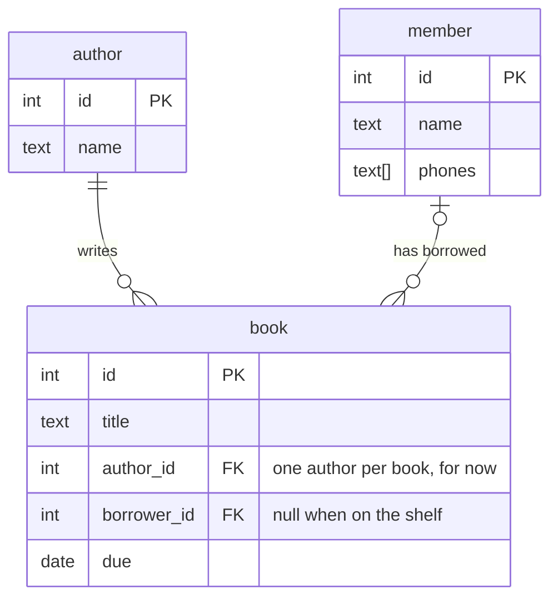
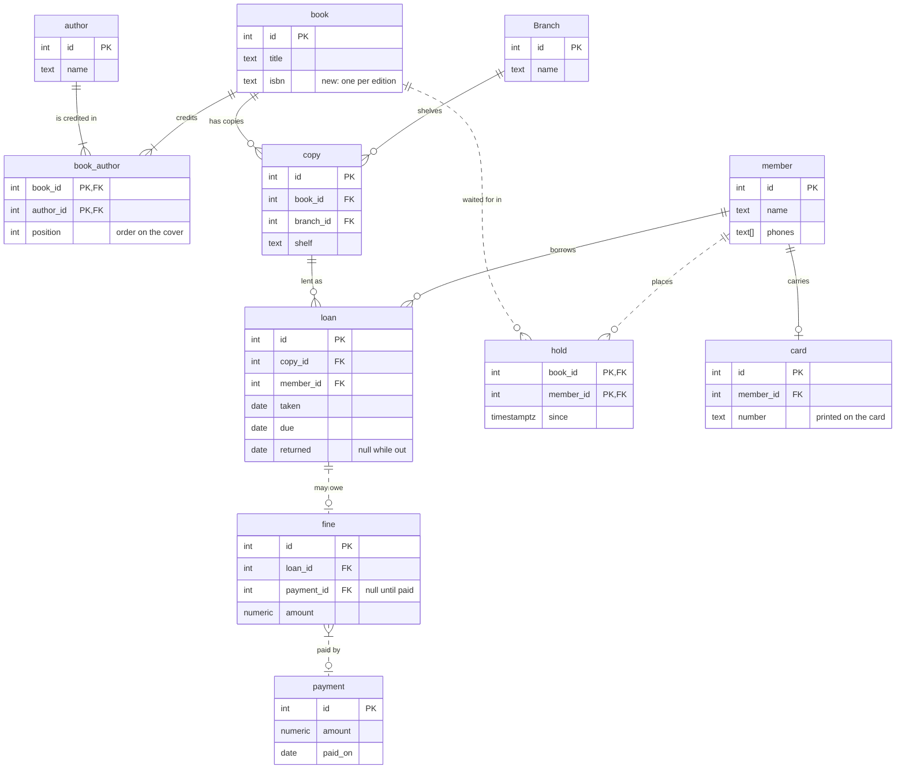

# Lending library

A small town library that lends books to its members.

## Current

One branch, one copy per book, and a loan is a row on the book itself.

## Planned

Several branches, many copies of a book, and loans kept as history.

