# Corner shop

An online shop for clothes and small home goods: a catalog with variants
and prices in several currencies, carts and orders, payments and refunds,
shipping from more than one warehouse, and reviews.

## Shop

Everything the shop keeps, in one diagram.

```mermaid
erDiagram
    brand {
        bigint id PK
        text name
        text website
    }
    category {
        bigint id PK
        bigint parent_id FK "null for top-level categories"
        text name
        text slug UK "used in the shop's URLs"
    }
    product {
        bigint id PK
        bigint brand_id FK
        bigint category_id FK
        text name
        text slug UK
        text description
        text[] tags
        boolean active "hidden from the shop when false"
        timestamptz created_at
    }
    product_image {
        bigint id PK
        bigint product_id FK
        text url
        int position "order in the gallery"
        text alt_text
    }
    variant {
        bigint id PK
        bigint product_id FK
        text sku UK
        text size
        text color
        int weight_g "for shipping costs"
    }
    attribute {
        bigint id PK
        text name
        text unit "null for words like cotton"
    }
    variant_attribute {
        bigint variant_id PK, FK
        bigint attribute_id PK, FK
        text value
    }
    currency {
        text code PK "ISO 4217"
        text name
        text symbol
        int decimals
    }
    price {
        bigint id PK
        bigint variant_id FK
        text currency_code FK
        numeric amount
        date valid_from
        date valid_to "null while current"
    }
    collection {
        bigint id PK
        text name
        text slug UK
        timestamptz starts_at
        timestamptz ends_at
    }
    collection_product {
        bigint collection_id PK, FK
        bigint product_id PK, FK
        int position
    }
    customer {
        bigint id PK
        text email UK
        text name
        text[] phones
        boolean marketing_opt_in
        timestamptz created_at
    }
    country {
        text code PK "ISO 3166 alpha-2"
        text name
        numeric vat_rate
        boolean ships_to
    }
    address {
        bigint id PK
        bigint customer_id FK
        text line1
        text line2
        text city
        text postcode
        text country_code FK
    }
    customer_group {
        bigint id PK
        text name
        numeric discount_percent
    }
    customer_group_member {
        bigint customer_group_id PK, FK
        bigint customer_id PK, FK
        date since
    }
    wishlist {
        bigint id PK
        bigint customer_id FK
        text name
        boolean is_public
    }
    wishlist_item {
        bigint wishlist_id PK, FK
        bigint variant_id PK, FK
        timestamptz added_at
    }
    cart {
        bigint id PK
        bigint customer_id FK "null for guests"
        text session_token UK
        timestamptz updated_at
    }
    cart_item {
        bigint cart_id PK, FK
        bigint variant_id PK, FK
        int quantity
    }
    staff {
        bigint id PK
        text name
        text email UK
        text role "support, warehouse or admin"
    }
    order {
        bigint id PK
        text number UK "printed on the invoice"
        bigint customer_id FK
        bigint billing_address_id FK
        bigint shipping_address_id FK
        text currency_code FK
        text status "placed, paid, shipped, delivered or cancelled"
        timestamptz placed_at
        numeric total
    }
    order_line {
        bigint order_id PK, FK
        int line_no PK
        bigint variant_id FK
        int quantity
        numeric unit_price "price when ordered"
        numeric discount
    }
    order_status_change {
        bigint id PK
        bigint order_id FK
        text from_status
        text to_status
        timestamptz changed_at
        bigint changed_by_id FK "null when the customer did it"
    }
    coupon {
        bigint id PK
        text code UK
        numeric percent_off
        numeric amount_off "used when percent_off is null"
        timestamptz starts_at
        timestamptz ends_at
        int max_uses
    }
    coupon_use {
        bigint coupon_id PK, FK
        bigint order_id PK, FK
        timestamptz used_at
    }
    return_request {
        bigint id PK
        bigint order_id FK
        text reason
        text status "requested, approved, received or refused"
        timestamptz requested_at
    }
    return_line {
        bigint id PK
        bigint return_request_id FK
        bigint variant_id FK
        int quantity
        text condition "as checked in the warehouse"
    }
    refund {
        bigint id PK
        bigint return_request_id FK "null for goodwill refunds"
        bigint payment_id FK
        numeric amount
        timestamptz refunded_at
    }
    payment_method {
        bigint id PK
        text name
        text provider
        boolean active
    }
    payment {
        bigint id PK
        bigint order_id FK
        bigint payment_method_id FK
        text currency_code FK
        numeric amount
        text status "pending, captured, failed or refunded"
        text provider_ref "id at the payment provider"
        timestamptz paid_at
    }
    gift_card {
        bigint id PK
        text code UK
        numeric balance
        text currency_code FK
        date expires_on
    }
    gift_card_use {
        bigint gift_card_id PK, FK
        bigint payment_id PK, FK
        numeric amount
    }
    invoice {
        bigint id PK
        bigint order_id FK
        text number UK
        date issued_on
        text pdf_url
    }
    carrier {
        bigint id PK
        text name
        text tracking_url "with {code} where the tracking code goes"
    }
    shipping_method {
        bigint id PK
        bigint carrier_id FK
        text name
        numeric price
        int days_min
        int days_max
    }
    shipping_zone {
        bigint id PK
        text name
    }
    zone_country {
        bigint shipping_zone_id PK, FK
        text country_code PK, FK
    }
    shipment {
        bigint id PK
        bigint order_id FK
        bigint shipping_method_id FK
        bigint warehouse_id FK
        text tracking_code
        timestamptz shipped_at
        timestamptz delivered_at "null until the carrier confirms"
    }
    shipment_line {
        bigint shipment_id PK, FK
        bigint variant_id PK, FK
        int quantity
    }
    tracking_event {
        bigint id PK
        bigint shipment_id FK
        text status
        text location
        timestamptz happened_at
    }
    warehouse {
        bigint id PK
        text name
        text street
        text country_code FK
    }
    stock {
        bigint warehouse_id PK, FK
        bigint variant_id PK, FK
        int on_hand
        int reserved "held for orders not yet shipped"
    }
    supplier {
        bigint id PK
        text name
        text email
        text country_code FK
    }
    supply {
        bigint supplier_id PK, FK
        bigint variant_id PK, FK
        numeric cost
        int lead_days
    }
    restock {
        bigint id PK
        bigint supplier_id FK
        bigint warehouse_id FK
        timestamptz ordered_at
        date expected_on
    }
    restock_line {
        bigint restock_id PK, FK
        bigint variant_id PK, FK
        int quantity
        int received "null until the delivery is counted"
    }
    review {
        bigint id PK
        bigint product_id FK
        bigint customer_id FK
        int rating "1 to 5 stars"
        text title
        text body
        timestamptz created_at
    }
    review_vote {
        bigint review_id PK, FK
        bigint customer_id PK, FK
        boolean helpful
    }
    question {
        bigint id PK
        bigint product_id FK
        bigint customer_id FK
        text body
        timestamptz asked_at
    }
    answer {
        bigint id PK
        bigint question_id FK
        bigint staff_id FK "null when another customer answered"
        bigint customer_id FK "null when staff answered"
        text body
    }
    category |o..o{ category : contains
    brand ||..o{ product : makes
    category ||..o{ product : lists
    product ||--o{ product_image : "shown in"
    product ||--o{ variant : "comes as"
    variant ||--o{ variant_attribute : "described by"
    attribute ||--o{ variant_attribute : describes
    variant ||--o{ price : "priced as"
    price }o..|| currency : in
    collection ||--o{ collection_product : features
    product ||--o{ collection_product : "featured in"
    customer ||--o{ address : "lives at"
    address }o..|| country : in
    customer_group ||--o{ customer_group_member : includes
    customer ||--o{ customer_group_member : "belongs to"
    customer ||--o{ wishlist : keeps
    wishlist ||--o{ wishlist_item : holds
    variant ||--o{ wishlist_item : "wished for in"
    customer |o..o{ cart : fills
    cart ||--o{ cart_item : holds
    variant ||--o{ cart_item : "added to"
    customer ||..o{ order : places
    address ||..o{ order : "billing for"
    address ||..o{ order : "shipping for"
    order }o..|| currency : in
    order ||--|{ order_line : lists
    variant ||..o{ order_line : "ordered as"
    order ||--o{ order_status_change : "went through"
    staff |o..o{ order_status_change : changed
    coupon ||--o{ coupon_use : "used in"
    order ||--o{ coupon_use : redeems
    order ||--o{ return_request : "sent back as"
    return_line }|--|| return_request : "listed in"
    variant ||..o{ return_line : "returned as"
    return_request |o..o{ refund : "settled by"
    payment ||..o{ refund : "refunded by"
    order ||..o{ payment : "paid by"
    payment_method ||..o{ payment : "used for"
    payment }o..|| currency : in
    gift_card }o..|| currency : in
    gift_card ||--o{ gift_card_use : "spent in"
    payment ||--o{ gift_card_use : spends
    order ||--o| invoice : "billed as"
    carrier ||--o{ shipping_method : offers
    shipping_zone ||--o{ zone_country : covers
    country ||--o{ zone_country : "belongs to"
    order ||..o{ shipment : "sent as"
    shipping_method ||..o{ shipment : sends
    warehouse ||..o{ shipment : ships
    shipment ||--|{ shipment_line : packs
    variant ||--o{ shipment_line : "packed in"
    shipment ||--o{ tracking_event : "tracked by"
    warehouse }o..|| country : in
    warehouse ||--o{ stock : stores
    variant ||--o{ stock : "stocked as"
    supplier }o..|| country : "based in"
    supplier ||--o{ supply : supplies
    variant ||--o{ supply : "supplied as"
    supplier ||--o{ restock : fills
    warehouse ||..o{ restock : receives
    restock_line }|--|| restock : "listed in"
    variant ||--o{ restock_line : "restocked as"
    product ||--o{ review : "reviewed in"
    customer ||..o{ review : writes
    review ||--o{ review_vote : "rated by"
    customer ||--o{ review_vote : "votes on"
    product ||--o{ question : "asked about in"
    customer ||..o{ question : asks
    question ||--o{ answer : "answered by"
    staff |o..o{ answer : answers
    customer |o..o{ answer : answers
```

